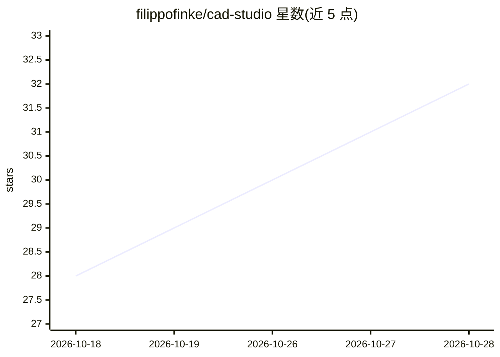

# filippofinke/cad-studio

⭐ 33 · Swift · MIT · 推送 2026-10-10 · [GitHub](https://github.com/filippofinke/cad-studio) · [官网](https://filippofinke.github.io/cad-studio/) · 个人维护

**macOS 原生 CAD 应用：用 Claude Code 生成参数化可打印 3D 模型**

面向 macOS 用户的原生 CAD 工作台：用户以自然语言描述零件，应用调用本机的 Claude Code 或 Codex CLI 以 headless 模式编写 build123d 参数化脚本 model.py，在专用 Python 虚拟环境中运行，产出 3D 模型、ISO 工程图（多页 PDF）与可直接切片的 3MF/STEP/STL 文件。每次生成都保存为可回溯的版本，含对话与 agent 会话。附带参数滑块、物理仿真动画、测量与剖切、多语言界面。要求 macOS 15+ 与已登录的 agent CLI；生成消耗用户自有订阅额度，简单零件需一至两分钟。

## 筛选速览

| 维度 | 判定 | 备注 |
|---|---|---|
| AI 角色 | `ai-enhanced` | 去掉 AI 部分产品仍成立 |
| 许可风险 | `permissive` | MIT |
| 部署形态 | `desktop` | 安装包/桌面程序 |
| 模型依赖 | locked-api |  |
| 硬件要求 | — | 无带数字的原话,不猜 |
| 安装摩擦 | `low` | 无编译、无系统依赖或容器化 |
| 成熟度 | — | 结构信号不足 |

## 能力要点

- agent 编写并运行 build123d 参数化脚本生成模型
- 输出 3MF/STEP/STL 与 ISO 工程图 PDF
- 版本历史：回退任意生成版本并恢复 agent 上下文
- 参数滑块免调用 agent 直接改尺寸

## 适用场景

- 用一句话描述并得到可 3D 打印的零件模型
- 对生成模型做装配爆炸、仿真动画与工程制图
- 迭代设计时对比历史版本并回退

## 场景标签

 · 领域:CAD/3D 打印工具

## 证据(README 行号)

> L6: > Describe a part, get a printable model. A native macOS CAD studio powered by the coding agent on your Mac (Claude 
> L8: Type "a print-in-place planetary gearbox with four colors, animated with real gear ratios" and CAD Studio has your c

## 星数曲线

2026-10-18 28 → 2026-10-28 32（+4）

---
*卡片 v1 · prompt 1.4 · 生成 2026-10-26 · 置信度 high · 依据 README sha `2870c785d8b7` · [字段定义](../../DATASET.md)*
