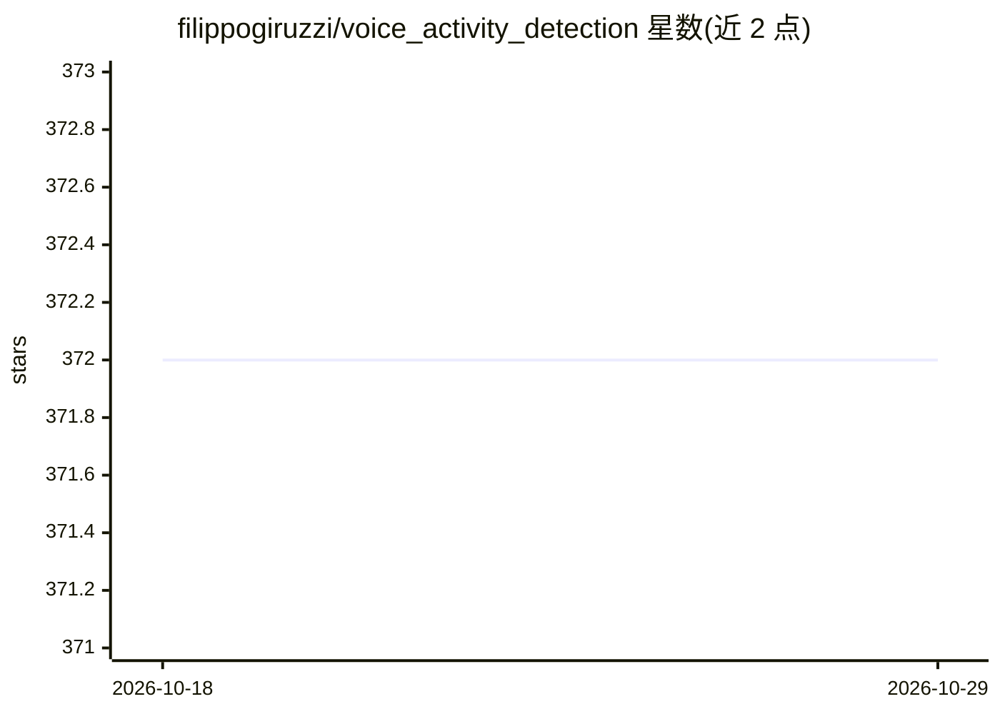

# filippogiruzzi/voice_activity_detection

⭐ 372 · Python · GPL-3.0 · 推送 2026-07-22 · [GitHub](https://github.com/filippogiruzzi/voice_activity_detection) · 个人维护

**基于 MFCC+1D-ResNet 的深度学习语音活动检测项目**

实时语音活动检测（VAD）算法的设计与实现项目：管道由 MFCC 特征提取（5 MFCC + delta + delta-delta + RMS 能量）与一个小型 1D-ResNet（PyTorch）组成，对 1024 采样点音频窗口做 speech/noise 二分类。提供数据集构建、训练与导出（state dict + TorchScript）、滑窗推理 CLI，训练设备自动选择 CUDA/Apple MPS/CPU，附 Docker CPU/GPU 镜像与 CI/CD。README 自述为 toy project，仅使用 LibriSpeech test-clean 子集划分数据。

## 筛选速览

| 维度 | 判定 | 备注 |
|---|---|---|
| AI 角色 | `ai-native` | 本体是模型或模型工具 |
| 许可风险 | `viral` | GPL-3.0 |
| 部署形态 | `self-host` | docker 或自建部署 |
| 模型依赖 | — | README 未给出锁定关系 |
| 硬件要求 | — | 无带数字的原话,不猜 |
| 安装摩擦 | `low` | 无编译、无系统依赖或容器化 |
| 成熟度 | `idea` | |

## 能力要点

- MFCC 特征提取 + 1D-ResNet 的 speech/noise 二分类管道
- CLI 覆盖数据构建、训练导出（TorchScript）与滑窗推理
- CPU/GPU Docker 镜像与 CI/CD 流水线
- 训练设备自动选择 CUDA / Apple MPS / CPU，带 TensorBoard 日志

## 适用场景

- 学习或实验基于深度学习的 VAD 管道
- 在 LibriSpeech 上训练并导出语音活动检测模型
- 对音频文件做滑窗语音/噪声判别推理

## 场景标签

 · 领域:语音/音频 AI

## 证据(README 行号)

> L64: The purpose of this project is to design and implement a real-time Voice Activity Detection algorithm based on Deep
> L66: The designed solution is based on a simple pipeline with MFCC feature extraction and a small 1D-ResNet model (PyTor
> L89: These features feed a configurable 1D-ResNet (`vad.model.Resnet1D`):

## 星数曲线

2026-10-18 372 → 2026-10-29 372（+0）

---
*卡片 v1 · prompt 1.4 · 生成 2026-10-21 · 置信度 high · 依据 README sha `779200b318c0` · [字段定义](../../DATASET.md)*
