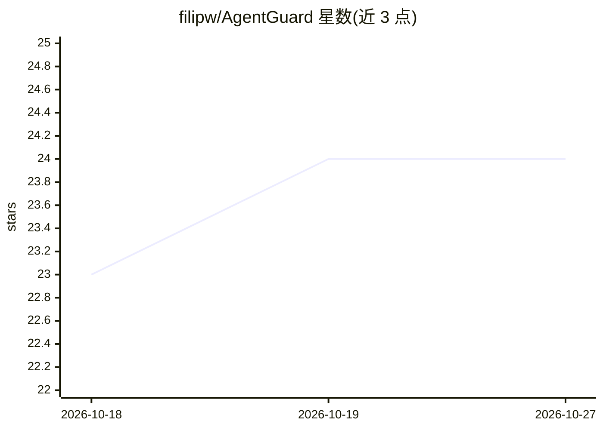

# filipw/AgentGuard

⭐ 24 · C# · MIT · 推送 2026-10-01 · [GitHub](https://github.com/filipw/AgentGuard) · [官网](https://filipw.github.io/AgentGuard/) · 个人维护

**.NET AI agent 的声明式安全护栏与防护规则库**

面向 .NET 开发者的 AI agent 护栏库：以可组合、可测试的声明式规则提供 PII 检测与脱敏、提示注入拦截、主题边界、Token 限额、密钥检测、内容安全、检索/工具调用/工具结果护栏及 LLM-as-judge 规则。核心引擎框架无关，可独立使用或经适配器接入 Microsoft Agent Framework、Semantic Kernel 等 .NET AI 技术栈，也可装饰任意 IChatClient。多数规则离线运行（含 ONNX 模型），另有 Azure 与远程分类器可选包，以 NuGet 包分发。

## 筛选速览

| 维度 | 判定 | 备注 |
|---|---|---|
| AI 角色 | `ai-ecosystem` | LLM/agent 周边工具 |
| 许可风险 | `permissive` | MIT |
| 部署形态 | `None` |  |
| 模型依赖 | local-ok | 支持本地模型 |
| 硬件要求 | — | 无带数字的原话,不猜 |
| 安装摩擦 | `medium` | 含编译或系统依赖之一 |
| 成熟度 | — | 结构信号不足 |

## 能力要点

- 声明式可组合规则：PII 脱敏、提示注入、密钥、Token 限额、内容安全
- 框架无关核心 + Microsoft Agent Framework / IChatClient 适配
- ONNX ML 规则与 Defender MiniLM 模型随 NuGet 打包、离线运行
- 检索/工具调用/工具结果三层 Agentic 护栏

## 适用场景

- 为 .NET AI agent 添加输入输出安全护栏
- 在检索内容与工具结果中拦截间接提示注入
- 对知识库内容与对话输出做 PII 检测与脱敏
- 离线/主权部署场景下用本地 ONNX 模型做内容安全分类

## 场景标签

`网络安全` · 领域:学习与行业

## 证据(README 行号)

> L9: What NeMo Guardrails and Guardrails AI do for Python, **AgentGuard** does for .NET - with the fluent APIs, composabl
> L15: The core engine is **framework-agnostic** - use it standalone, with Microsoft Agent Framework, Semantic Kernel, or 

## 星数曲线

2026-10-18 23 → 2026-10-27 24（+1）

---
*卡片 v1 · prompt 1.4 · 生成 2026-10-27 · 置信度 high · 依据 README sha `58ac5e296f96` · [字段定义](../../DATASET.md)*
