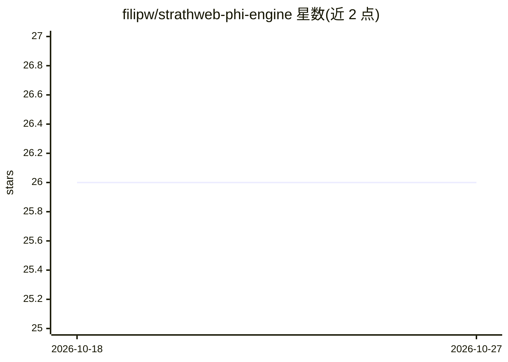

# filipw/strathweb-phi-engine

⭐ 26 · Rust · MIT · 推送 2026-06-05 · [GitHub](https://github.com/filipw/strathweb-phi-engine) · 个人维护

**跨平台本地运行 Microsoft Phi 模型的推理库（C#/Swift/Kotlin/Python 绑定）**

基于 Rust candle 后端的 Phi 模型本地推理引擎，支持 GGUF 与 safetensors 格式，通过 UniFFI 生成 Swift/.NET/Kotlin/Python 四种语言绑定，覆盖 macOS/iOS/Windows/Linux 多平台。macOS 支持 Metal GPU，其他平台仅 CPU。仓库另含 C# 的 AutoGen 与 Microsoft Agent Framework 集成库，可将本地 Phi-3 封装为 agent 参与工作流。安装以源码构建为主：各语言有对应构建脚本或 dotnet/cargo 命令。

## 筛选速览

| 维度 | 判定 | 备注 |
|---|---|---|
| AI 角色 | `ai-ecosystem` | LLM/agent 周边工具 |
| 许可风险 | `permissive` | MIT |
| 部署形态 | `library` | 以包/库形式分发 |
| 模型依赖 | local-ok | 支持本地模型 |
| 硬件要求 | — | 无带数字的原话,不猜 |
| 安装摩擦 | `high` | 编译与系统依赖俱全 |
| 成熟度 | — | 结构信号不足 |

## 能力要点

- candle 后端运行 Phi 模型，支持 GGUF 与 safetensors 格式
- Swift/.NET/Kotlin/Python 四语言绑定，含 iOS 支持
- macOS 支持 Metal GPU，其余平台 CPU 运行
- AutoGen 与 Microsoft Agent Framework 的 C# agent 集成库

## 适用场景

- 在 .NET/Swift/Kotlin/Python 应用中本地运行 Phi 模型
- 在 iOS 设备上部署量化 Phi 模型推理
- 把本地 Phi-3 接入 AutoGen 或 Agent Framework 工作流

## 场景标签

`推理引擎` · 领域:训练与推理

## 证据(README 行号)

> L3: A cross-platform library for running Microsoft's Phi models locally using candle in GGUF and safe tensors format.
> L7: ||**Swift**|**.NET**|**Kotlin**|**Python**|

## 星数曲线

2026-10-18 26 → 2026-10-27 26（+0）

---
*卡片 v1 · prompt 1.4 · 生成 2026-10-26 · 置信度 high · 依据 README sha `4947d92faeaa` · [字段定义](../../DATASET.md)*
