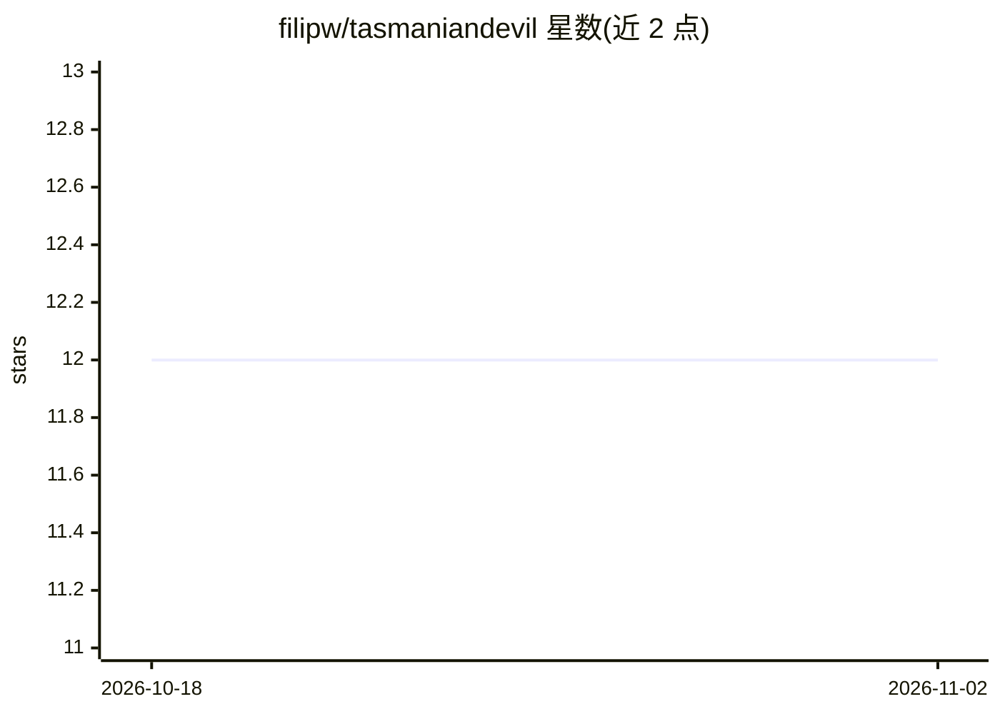

# filipw/tasmaniandevil

⭐ 12 · C# · MIT · 推送 2026-09-12 · [GitHub](https://github.com/filipw/tasmaniandevil) · [官网](https://filipw.github.io/tasmaniandevil/) · 个人维护

**.NET 的上下文感知 PII 检测与去标识化引擎**

以 C# 从零实现的 PII 检测与脱敏库，架构参考 Microsoft Presidio。核心引擎离线运行、零模型依赖，识别器带校验和验证（Luhn、IBAN mod-97、Verhoeff 等）与基于 Porter 词干匹配的上下文评分；提供 replace/hash/encrypt 等可逆操作符，支持 JSON/CSV/批量脱敏。可选附件包接入 ONNX GLiNER 跨语言 NER 模型（约 580MB）、通用 HTTP 远程检测或 Azure AI Language。面向 .NET 开发者，MIT 许可。

## 筛选速览

| 维度 | 判定 | 备注 |
|---|---|---|
| AI 角色 | `ai-native` | 本体是模型或模型工具 |
| 许可风险 | `permissive` | MIT |
| 部署形态 | `None` |  |
| 模型依赖 | — | README 未给出锁定关系 |
| 硬件要求 | — | 无带数字的原话,不猜 |
| 安装摩擦 | `medium` | 含编译或系统依赖之一 |
| 成熟度 | — | 结构信号不足 |

## 能力要点

- 识别器带真实校验和验证（Luhn、IBAN mod-97、Verhoeff、bech32 等）
- 上下文感知评分：邻近词（card、IBAN 等）经 Porter 词干匹配提升得分
- 可逆设计：AES-GCM 加密后可逐字节还原原文
- 离线零模型核心，可选 ONNX GLiNER 多语言 NER 与 Azure/HTTP 远程检测附件包

## 适用场景

- 在 .NET 应用中对文本、JSON、CSV 做 PII 脱敏后再交给第三方处理
- 按国家包（uk/de/in 等）检测各国身份证、税号、护照等敏感数据
- 需要脱敏后仍能解密还原原文的合规场景

## 场景标签

 · 领域:隐私工程/文本处理

## 证据(README 行号)

> L3: **Context-aware PII detection and de-identification for .NET.** A from-scratch engine whose
> L76: `TasmanianDevil.Onnx` adds **PERSON / LOCATION / ORGANIZATION / DATE_TIME** span detection - the entity
> L103: `TasmanianDevil.Azure` talks directly to the Azure AI Language REST API (no `Azure.AI.TextAnalytics`

## 星数曲线

2026-10-18 12 → 2026-11-02 12（+0）

---
*卡片 v1 · prompt 1.4 · 生成 2026-11-01 · 置信度 high · 依据 README sha `ef8cb626e300` · [字段定义](../../DATASET.md)*
