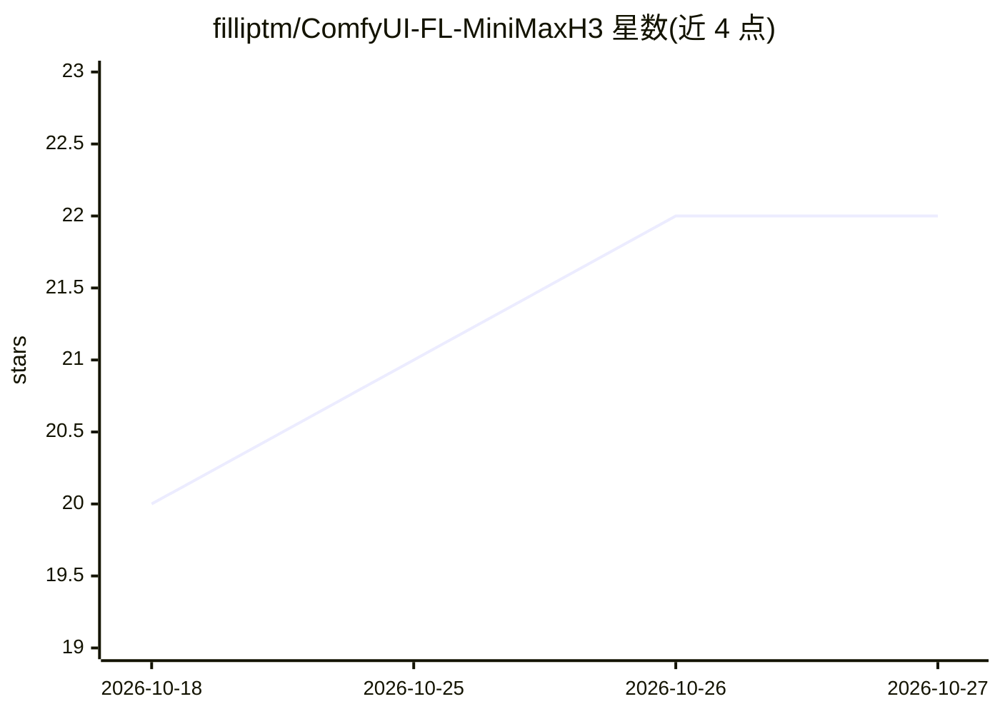

# filliptm/ComfyUI-FL-MiniMaxH3

⭐ 22 · Python · Apache-2.0 · 推送 2026-09-14 · [GitHub](https://github.com/filliptm/ComfyUI-FL-MiniMaxH3) · 个人维护

**ComfyUI 的 MiniMax H3 视频生成工作流节点包**

面向 ComfyUI 用户与视频生成工作流开发者的 MiniMax H3 自定义节点集：提供按秒/帧/节拍的提示词时间线、节拍分镜规划、全帧时间段重绘、跨镜头运动上下文、保持 H3 嵌套视频/音频潜空间结构的采样、原生潜空间上采样、像素空间精修与镜头拼接。LoRA Block Loader 节点按块加载 H3 适配器；Motion Refine 节点依赖 ComfyUI-MAINodes 的本地扩展方法，非上游自带。

## 筛选速览

| 维度 | 判定 | 备注 |
|---|---|---|
| AI 角色 | `ai-ecosystem` | LLM/agent 周边工具 |
| 许可风险 | `permissive` | Apache-2.0 |
| 部署形态 | `None` |  |
| 模型依赖 | — | README 未给出锁定关系 |
| 硬件要求 | — | 无带数字的原话,不猜 |
| 安装摩擦 | `medium` | 含编译或系统依赖之一 |
| 成熟度 | — | 结构信号不足 |

## 能力要点

- 按秒/帧/节拍的严格提示词时间线与节拍分镜规划
- 时间段重绘：重生成指定区间并保持其余片段不变
- 保持 H3 嵌套视频/音频潜空间结构的采样与原生潜空间上采样
- LoRA Block Loader 支持按 transformer 块/精炼器分层控制适配器强度

## 适用场景

- 在 ComfyUI 中按节拍规划并分镜生成 H3 视频
- 对已生成视频做局部时间段重绘与运动精修
- 对 H3 模型按块调节 LoRA 权重进行消融实验

## 场景标签

`视频生成` · 领域:内容生成

## 证据(README 行号)

> L3: MiniMax H3 workflow nodes for ComfyUI. The pack adds strict prompt timelines, beat-aligned render planning, full-fra
> L15: - **Nested latent sampling** - Sample MiniMax H3 video and audio latents without flattening their native structure
> L50: This node requires ComfyUI-MAINodes, including the `H3TimeSmear.plan` addition, and the companion ComfyUI H3 VAE me

## 星数曲线

2026-10-18 20 → 2026-10-27 22（+2）

---
*卡片 v1 · prompt 1.4 · 生成 2026-10-27 · 置信度 high · 依据 README sha `b1d0ca0d4239` · [字段定义](../../DATASET.md)*
