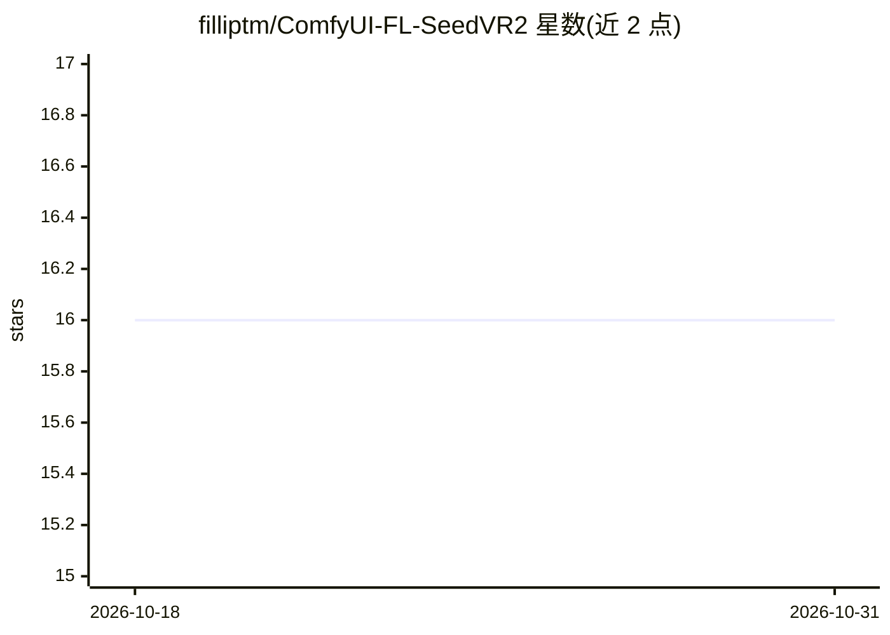

# filliptm/ComfyUI-FL-SeedVR2

⭐ 16 · Python · Apache-2.0 · 推送 2026-08-03 · [GitHub](https://github.com/filliptm/ComfyUI-FL-SeedVR2) · 个人维护 · 中文 README

**ComfyUI 的 SeedVR2 1.4B 图像修复与放大节点包**

面向 ComfyUI 用户的自定义节点包：提供 Loader 与 Upscale 两个节点，加载固定版本的 SeedVR2 1.4B 六块蒸馏模型（fp16，约 2.89 GB）与配套 VAE，执行一步式去噪、去模糊、锐化与 1x-8x 放大（推荐 4x）。直接使用 ComfyUI 内建的 SeedVR2 模型路径、设备管理与 offloading，不捆绑第二套实现。首次执行时可自动下载模型，带 SHA-256 校验与断点续传。支持 RGB/RGBA 与批量处理；视频、GGUF、训练不在本版本范围内。

## 筛选速览

| 维度 | 判定 | 备注 |
|---|---|---|
| AI 角色 | `ai-native` | 本体是模型或模型工具 |
| 许可风险 | `permissive` | Apache-2.0 |
| 部署形态 | `None` |  |
| 模型依赖 | — | README 未给出锁定关系 |
| 硬件要求 | — | 无带数字的原话,不猜 |
| 安装摩擦 | `medium` | 含编译或系统依赖之一 |
| 成熟度 | — | 结构信号不足 |

## 能力要点

- 一步式图像修复：去噪/去模糊/锐化/细节恢复
- 1x-8x 放大，默认推荐 4x
- 首次使用自动下载并 SHA-256 校验固定的 transformer 与 VAE
- 复用 ComfyUI 内建 SeedVR2 路径与内存管理，支持批量与 RGBA

## 适用场景

- 在 ComfyUI 工作流中对图片做修复与 4x 放大
- 批量处理 RGBA 透明图片的画质增强
- 希望节点自动下载并管理 SeedVR2 模型文件

## 场景标签

`图像视频处理` · 领域:感知与多模态

## 证据(README 行号)

> L17: - **One-step restoration** - Denoise, deblur, sharpen, and restore image detail
> L33: |**FL SeedVR2 1.4B Loader**|Loads the pinned 1.4B transformer and VAE, with optional automatic download|

## 星数曲线

2026-10-18 16 → 2026-10-31 16（+0）

---
*卡片 v1 · prompt 1.4 · 生成 2026-10-30 · 置信度 high · 依据 README sha `d94b6c8a7c99` · [字段定义](../../DATASET.md)*
