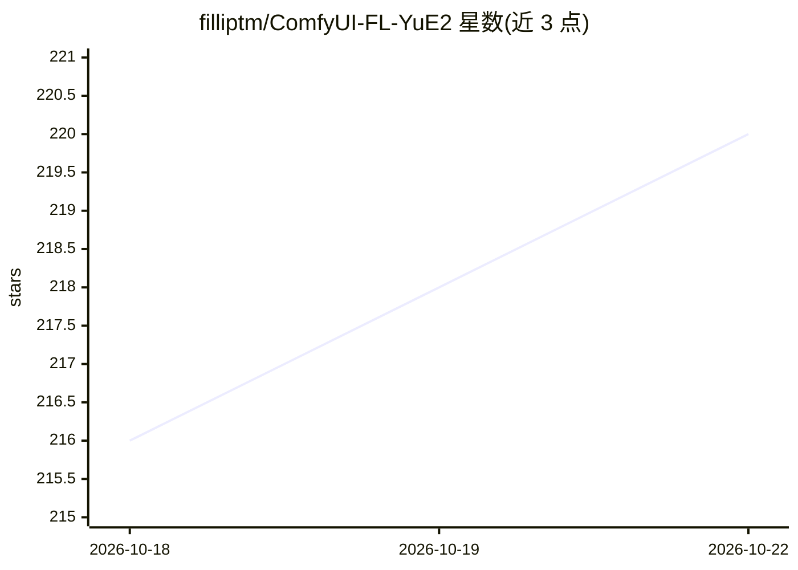

# filliptm/ComfyUI-FL-YuE2

⭐ 220 · Python · Apache-2.0 · 推送 2026-09-23 · [GitHub](https://github.com/filliptm/ComfyUI-FL-YuE2) · 个人维护

**ComfyUI 的 YuE2 音乐生成节点包，带可编辑钢琴卷帘**

ComfyUI 自定义节点集合，封装 YuE2-3B 模型的推理与训练：从歌词与风格描述生成 48 kHz 立体声音乐，支持 full/melody/off 三种规划模式与 ABC 乐谱导入；提供 MIDI 风格的可编辑钢琴卷帘（音符绘制、和弦轨道、移调、试听）。训练侧支持 AR 与联合 AR/NAR LoRA 训练、数据集准备与 SheetSage2 转录。首次运行下载约 7.8 GB 模型；要求支持 BF16 的 NVIDIA GPU，仅在 Windows/RTX PRO 6000 Blackwell 上验证，其他设备未验证。

## 筛选速览

| 维度 | 判定 | 备注 |
|---|---|---|
| AI 角色 | `ai-native` | 本体是模型或模型工具 |
| 许可风险 | `permissive` | Apache-2.0 |
| 部署形态 | `desktop` | 安装包/桌面程序 |
| 模型依赖 | — | README 未给出锁定关系 |
| 硬件要求 | — | 无带数字的原话,不猜 |
| 安装摩擦 | `medium` | 含编译或系统依赖之一 |
| 成熟度 | — | 结构信号不足 |

## 能力要点

- 歌词+风格生成音乐，渲染 48 kHz 立体声音频
- MIDI 风格可编辑钢琴卷帘（音符编辑、和弦轨道、ABC 导入导出）
- AR 与联合 AR/NAR LoRA 训练工作流及 checkpoint 试听
- 模型下载支持断点续传与 manifest 校验，可离线使用

## 适用场景

- 在 ComfyUI 中从歌词和风格描述生成歌曲
- 用钢琴卷帘编辑旋律与和弦后再渲染音频
- 用自己的录音与字幕训练 YuE2 LoRA

## 场景标签

`微调` · 领域:训练与推理

## 证据(README 行号)

> L3: YuE2 inference workflow in ComfyUI
> L11: Compose songs from lyrics and style, build or import an ABC score, and render 48 kHz stereo audio with YuE2-3B. Gen

## 星数曲线

2026-10-18 216 → 2026-10-22 220（+4）

---
*卡片 v1 · prompt 1.4 · 生成 2026-10-22 · 置信度 mid · 依据 README sha `72a88dbe2217` · [字段定义](../../DATASET.md)*
