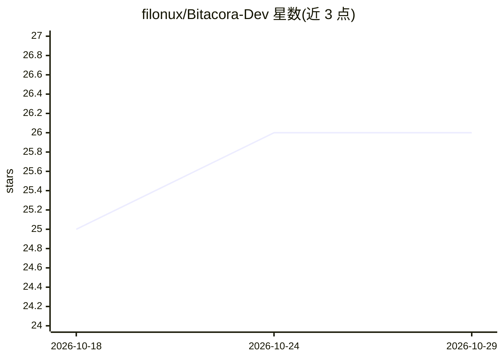

# filonux/Bitacora-Dev

⭐ 26 · HTML · NOASSERTION · 推送 2026-10-11 · [GitHub](https://github.com/filonux/Bitacora-Dev) · [官网](https://filonux.github.io/Bitacora-Dev/) · 个人维护

**浏览器本地运行的项目日志工具：记录版本、决策与任务，AI 可选**

运行于现代浏览器的本地优先（local-first）项目日志应用：以项目为单位组织版本（含版本树与回退记录）、指令与笔记、决策、待办任务，数据存于 localStorage 并支持 JSON/TXT/DOCX/PDF 导入导出。核心功能（历史、编辑、搜索、回退、项目管理）不依赖 AI；连接模型后提供上下文助手：总结项目演化、比较版本的语义变化、检测矛盾、提取待办、改写笔记文本。提供商可配置 LM Studio、Ollama、OpenAI、Anthropic 等本地或云端服务。无安装步骤，打开单个 HTML 文件即可使用。

## 筛选速览

| 维度 | 判定 | 备注 |
|---|---|---|
| AI 角色 | `ai-enhanced` | 去掉 AI 部分产品仍成立 |
| 许可风险 | `none` | NOASSERTION |
| 部署形态 | `None` |  |
| 模型依赖 | local-ok | 支持本地模型 |
| 硬件要求 | — | 无带数字的原话,不猜 |
| 安装摩擦 | `low` | 无编译、无系统依赖或容器化 |
| 成熟度 | — | 结构信号不足 |

## 能力要点

- 版本树、回退关系与持久化待办任务的项目历史记录
- AI 助手基于已记录历史工作：总结、语义变更分析、矛盾检测、待办提取与文本改写
- 支持本地（LM Studio/Ollama）与云端提供商，密钥存于浏览器
- 导入 JSON/TXT/Markdown/DOCX/PDF，导出 TXT/DOCX/PDF 与 JSON 备份

## 适用场景

- 为软件或研究项目保存版本、决策与变更的历史脉络
- 让 AI 基于历史总结演化、检测矛盾并提取待办任务
- 在浏览器中本地管理项目记录，无需后端与安装

## 场景标签

`知识库管理` · 领域:知识与检索

## 证据(README 行号)

> L11: The application runs directly in the browser and is designed to work locally. AI is optional: history, editors, sea
> L108: Without a connected provider, this section is disabled and says so explicitly; the rest of the application keeps w

## 星数曲线

2026-10-18 25 → 2026-10-29 26（+1）

---
*卡片 v1 · prompt 1.4 · 生成 2026-10-26 · 置信度 high · 依据 README sha `da7fae83d67d` · [字段定义](../../DATASET.md)*
