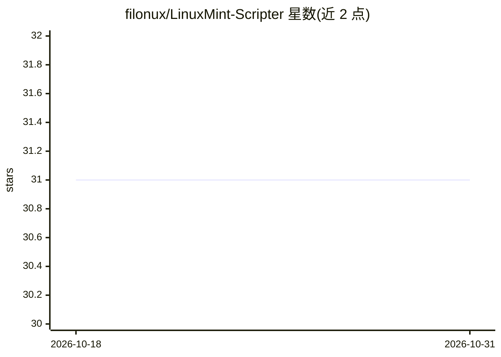

# filonux/LinuxMint-Scripter

⭐ 31 · HTML · NOASSERTION · 推送 2026-08-29 · [GitHub](https://github.com/filonux/LinuxMint-Scripter) · [官网](https://filonux.github.io/LinuxMint-Scripter/) · 个人维护

**面向 Linux Mint 的单文件网页版 AI 脚本生成与审查工具**

单文件 HTML 应用（原生 HTML/CSS/JS，无框架、无编译），把自然语言请求转换为可在 Linux Mint 22.3 上运行的 Bash 或 Python 3 脚本或终端命令。内置 Mint 特定知识的 system prompt（Nemo、Flatpak、mintupdate-cli 等）。支持本地 LM Studio/Ollama 及 OpenAI/Anthropic 兼容 API（BYOK），全部运行于浏览器内，无中间服务器。提供 CodeMirror 编辑器、1-3 轮迭代式审计修正、危险命令的本地启发式检测、cron/systemd 部署打包。已知限制：危险命令检测为启发式、非完整 parser，内嵌的不是真实 ShellCheck。

## 筛选速览

| 维度 | 判定 | 备注 |
|---|---|---|
| AI 角色 | `ai-native` | 本体是模型或模型工具 |
| 许可风险 | `none` | NOASSERTION |
| 部署形态 | `None` |  |
| 模型依赖 | local-ok | 支持本地模型 |
| 硬件要求 | — | 无带数字的原话,不猜 |
| 安装摩擦 | `low` | 无编译、无系统依赖或容器化 |
| 成熟度 | — | 结构信号不足 |

## 能力要点

- 自然语言生成 Bash/Python 脚本，内置 Linux Mint 22.3 特定上下文
- 多提供商 BYOK：本地 LM Studio/Ollama 与 OpenAI/Anthropic 兼容 API
- 1-3 轮迭代审计修正与片段级 diff 修订
- 打包部署为 .sh 安装器或 cron/systemd 任务

## 适用场景

- 用自然语言快速生成 Linux Mint 可用的系统管理脚本
- 让 AI 审查并迭代修正已有脚本
- 把生成的脚本连同定时任务一起部署到系统

## 场景标签

`代码生成` `代码审查` · 领域:编码与开发

## 证据(README 行号)

> L3: **Generador y revisor de scripts (Bash / Python) asistido por IA, hecho a medida para Linux Mint 22.3 «Zena»**
> L10: LinuxMint Scripter es una aplicación web de **un único archivo HTML** (HTML + CSS + JavaScript vanilla, sin framewo
> L38: - Chat en lenguaje natural para pedir scripts o comandos.

## 星数曲线

2026-10-18 31 → 2026-10-31 31（+0）

---
*卡片 v1 · prompt 1.4 · 生成 2026-10-26 · 置信度 high · 依据 README sha `682f269e6fd1` · [字段定义](../../DATASET.md)*
