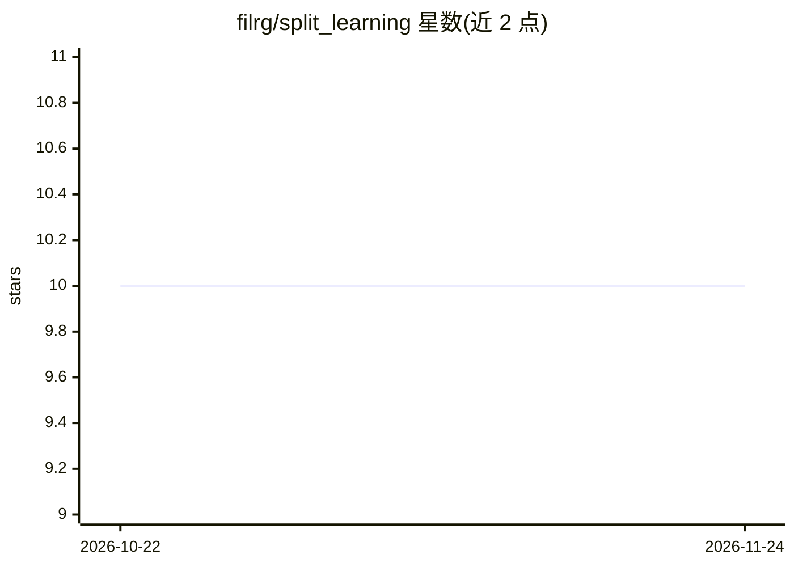

# filrg/split_learning

⭐ 10 · Python · Apache-2.0 · 推送 2026-09-05 · [GitHub](https://github.com/filrg/split_learning) · 个人维护

**基于 PyTorch+RabbitMQ 的分布式拆分学习训练实现**

实现拆分学习（Split Learning）分布式训练：将 DNN 拆分到服务器与多个客户端，客户端只传输中间激活而非原始数据，由 RabbitMQ 队列服务器充当通信枢纽，服务器按拓扑配置并分发模型参数，客户端以 --layer_id 与 --performance 参数接入并可通过 --device 指定 CPU。支持 VGG16 模型，训练轮次后保存 *.pth 参数文件，删除该文件可重置训练。标注版本 3.0.0、开发中，推理模式等功能在 TODO 中。

## 筛选速览

| 维度 | 判定 | 备注 |
|---|---|---|
| AI 角色 | `ai-native` | 本体是模型或模型工具 |
| 许可风险 | `permissive` | Apache-2.0 |
| 部署形态 | `self-host` | docker 或自建部署 |
| 模型依赖 | — | README 未给出锁定关系 |
| 硬件要求 | — | 无带数字的原话,不猜 |
| 安装摩擦 | `low` | 无编译、无系统依赖或容器化 |
| 成熟度 | `idea` | |

## 能力要点

- 模型拆分训练，客户端仅共享中间激活保护数据隐私
- RabbitMQ 作为统一消息队列通信枢纽（提供 docker-compose 配置）
- 客户端可声明设备算力并指定 cpu 运行
- 训练参数以 *.pth 文件持久化并支持重置

## 适用场景

- 在医疗、金融等数据敏感场景做隐私保护的分布式模型训练
- 让算力受限的设备（如移动端）参与联合训练
- 研究拆分学习/联邦学习的通信与训练流程

## 场景标签

`模型训练` · 领域:训练与推理

## 证据(README 行号)

> L7: **Split learning** is a method of distributed deep learning training, where a machine learning model is split into m
> L10: - **Model splitting**: The deep learning model is divided into two (or more) parts. For example, part of the model 
> L86: python server.py

## 星数曲线

2026-10-22 10 → 2026-11-24 10（+0）

---
*卡片 v1 · prompt 1.4 · 生成 2026-11-20 · 置信度 mid · 依据 README sha `d8ae0864b0cd` · [字段定义](../../DATASET.md)*
