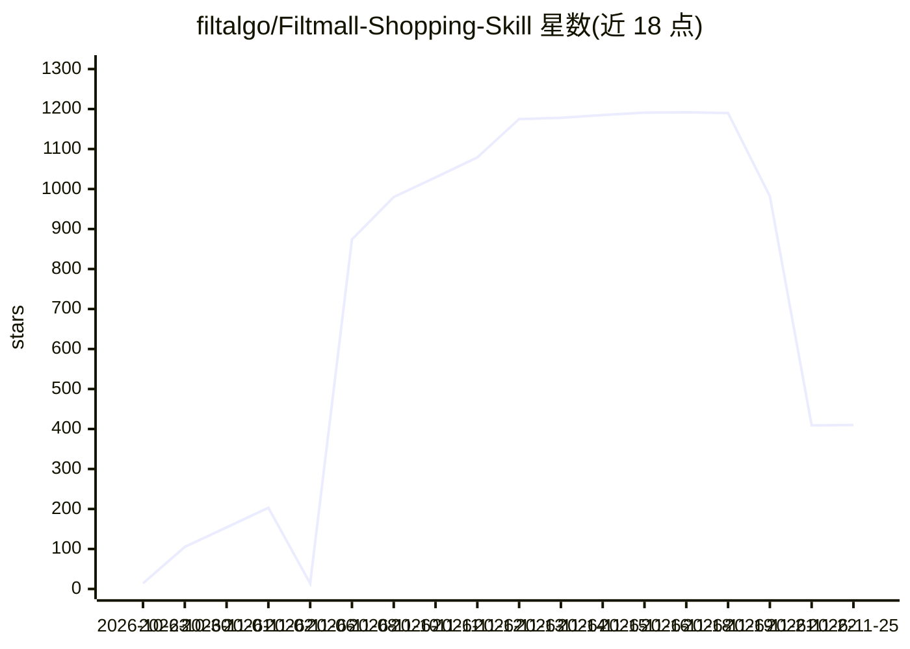

# filtalgo/Filtmall-Shopping-Skill

⭐ 410 · Python · Apache-2.0 · 推送 2026-11-23 · [GitHub](https://github.com/filtalgo/Filtmall-Shopping-Skill) · [官网](https://www.filtalgo.com/) · 组织维护 · 中文 README

**电商购物 Agent Skill：对话式选品到下单售后全流程**

筛电的通用托管购物 Agent Skill（v2.4.3），供宿主 Agent 通过自然语言为用户提供从选品到售后的购物能力。默认连接生产环境，以 Python 3.10+ 标准库自动管理访客身份；搜索结果以 Markdown 正文逐款展示标题、价格、商品图与详情链接，经公开 Gateway 转为 H5/小程序双入口。会员业务需单独授权，购物车、订单、售后等写操作须用户明确确认；凭据存于私有状态目录（0700/0600）。安装仅需复制目录，无 pip 依赖。

## 筛选速览

| 维度 | 判定 | 备注 |
|---|---|---|
| AI 角色 | `ai-native` | 本体是模型或模型工具 |
| 许可风险 | `permissive` | Apache-2.0 |
| 部署形态 | `library` | 以包/库形式分发 |
| 模型依赖 | — | README 未给出锁定关系 |
| 硬件要求 | — | 无带数字的原话,不猜 |
| 安装摩擦 | `low` | 无编译、无系统依赖或容器化 |
| 成熟度 | — | 结构信号不足 |

## 能力要点

- 对话式完成发现比价、详情咨询、购物车与地址、结算与物流跟进四阶段
- 首轮聊天正文直接呈现可读商品信息与真实商城入口（display_file Markdown 模式）
- 访客身份自动申请刷新，会员授权与写操作须用户逐次确认
- 离线省市区解析与 GitHub Release 更新提醒

## 适用场景

- 让宿主 Agent 帮我用自然语言按预算和偏好找商品并查看比价证据
- 在对话里管理购物车、提交订单并跟踪物流与售后
- 为 WorkBuddy、豆包工作等宿主接入购物技能并展示商品卡片

## 场景标签

 · 领域:电商/购物助手

## 证据(README 行号)

> L5: **用自然语言完成从选品到购物的对话，首轮直接在聊天正文中呈现可读商品信息与真实入口。**
> L7: Filtmall Shopping 是筛电通用托管购物 Agent Skill。默认连接**生产环境**，通过 Python 3.10+ 标准库自动申请和刷新访客身份；会员业务需单独完成用户授权，所有写操作须经用户明确确认。

## 星数曲线

2026-10-23 14 → 2026-11-25 410（+396）

---
*卡片 v1 · prompt 1.4 · 生成 2026-11-25 · 置信度 low · 依据 README sha `c848035b9ba3` · [字段定义](../../DATASET.md)*
