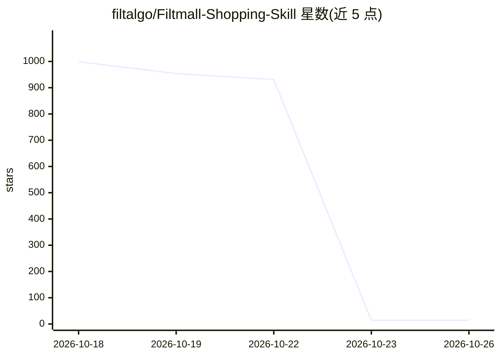

# filtalgo/Filtmall-Shopping-Skill

⭐ 14 · JavaScript · Apache-2.0 · 推送 2026-09-17 · [GitHub](https://github.com/filtalgo/Filtmall-Shopping-Skill) · [官网](https://www.filtalgo.com/) · 组织维护 · 中文 README

**让 AI 代理完成网购全流程的 Filtmall 官方技能**

筛电（Filtmall/Filtalgo）官方发布的 Agent 购物技能：通过 Node.js CLI 将 AI 代理接入 Filtmall 的商品与交易服务，覆盖商品发现、比价证据（同规格外部价格、来源平台、记录时间）、购物车与结算、订单与物流查询及售后流程。当前目录聚焦美妆个护；账户授权、订单确认与支付由买家自行完成。需 Node.js 18+，自带 CLI 运行时，无需单独 npm install。

## 筛选速览

| 维度 | 判定 | 备注 |
|---|---|---|
| AI 角色 | `ai-ecosystem` | LLM/agent 周边工具 |
| 许可风险 | `permissive` | Apache-2.0 |
| 部署形态 | `library` | 以包/库形式分发 |
| 模型依赖 | — | README 未给出锁定关系 |
| 硬件要求 | — | 无带数字的原话,不猜 |
| 安装摩擦 | `low` | 无编译、无系统依赖或容器化 |
| 成熟度 | — | 结构信号不足 |

## 能力要点

- 结构化返回实时价格、规格、库存与比价证据
- 一条命令接口覆盖搜索/购物车/结算/订单/物流/售后
- OAuth Device Flow 认证，支付与授权链接由买家打开
- 账户与交易数据变更前需确认的安全规则

## 适用场景

- 用一句话让 AI 代理找到并对比商品
- 让代理查询订单、物流并进入售后流程
- 展示商品相对于外部平台同规格商品的价格证据

## 场景标签

 · 领域:电商/Agent 技能

## 证据(README 行号)

> L12: Filtmall Shopping is the official shopping skill from 筛电 (Filtmall/Filtalgo). It gives AI agents live products, sam
> L61:     A --> S["Filtmall Shopping Skill"]
> L73: The bundled CLI connects the agent to Filtmall's product and transaction services. The repository contains the agen

## 星数曲线

2026-10-18 999 → 2026-10-26 14（-985）

---
*卡片 v1 · prompt 1.4 · 生成 2026-10-21 · 置信度 high · 依据 README sha `e144a9a8c024` · [字段定义](../../DATASET.md)*
