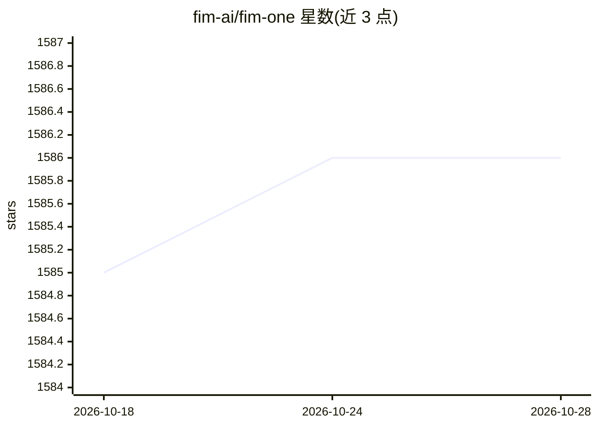

# fim-ai/fim-one

⭐ 1,586 · Python · NOASSERTION · 推送 2026-10-28 · [GitHub](https://github.com/fim-ai/fim-one) · [官网](https://one.fim.ai) · 组织维护 · 中文 README

**面向全球化与国内系统互联的自托管一体化 Agent 平台**

自托管的 Agent 平台，将企业既有系统（ERP、CRM、数据库、IM 等，含飞书/企微/钉钉/达梦/人大金仓等国内体系）接入同一个 agent 核心，提供 Standalone 助手、嵌入式 Copilot、中心化 Hub 三种交付模式。执行层含 LLM 动态 DAG 规划、并发执行、ReAct 循环、Hook 审批系统、内容护栏与评测中心，支持任意 OpenAI 兼容模型提供商。技术栈为 FastAPI + Next.js 14，Docker Compose 部署，多租户与 JWT 认证，另提供托管云版本（cloud.fim.ai，早期访问）。

## 筛选速览

| 维度 | 判定 | 备注 |
|---|---|---|
| AI 角色 | `ai-ecosystem` | LLM/agent 周边工具 |
| 许可风险 | `none` | NOASSERTION |
| 部署形态 | `self-host` | docker 或自建部署 |
| 模型依赖 | local-ok | 支持本地模型 |
| 硬件要求 | — | 无带数字的原话,不猜 |
| 安装摩擦 | `low` | 无编译、无系统依赖或容器化 |
| 成熟度 | — | 结构信号不足 |

## 能力要点

- LLM 运行时动态 DAG 规划与并发执行，最多 3 轮自动重规划
- 连接 PostgreSQL/MySQL/Oracle 及达梦、KingbaseES、GBase、Highgo 等国内数据库
- Hook 系统在 LLM 循环外执行确定性审批（飞书群审批卡片）与审计
- 兼容任意 OpenAI 兼容提供商，含 OpenAI/DeepSeek/Anthropic/Ollama 配置表

## 适用场景

- 把跨国企业的全球 SaaS 与国内系统接入同一 agent 核心统一编排
- 在飞书等 IM 群内对敏感工具调用做人工审批的 agent 执行
- 通过可视化工作流编辑器或 OpenAPI 导入构建 agent 工具

## 场景标签

`工作流自动化` `模型评测` `RAG` `Agent 框架` · 领域:Agent 开发

## 证据(README 行号)

> L22: Global enterprises run a sprawl of systems that don't talk to each other — ERP, CRM, OA, HR, finance, databases, IM
> L104: - **Three delivery modes** — Standalone assistant, embedded Copilot, or central Hub; same agent core.
> L162: FIM One works with **any OpenAI-compatible provider**:

## 星数曲线

2026-10-18 1,585 → 2026-10-28 1,586（+1）

---
*卡片 v1 · prompt 1.4 · 生成 2026-10-21 · 置信度 high · 依据 README sha `17715cc55eb0` · [字段定义](../../DATASET.md)*
