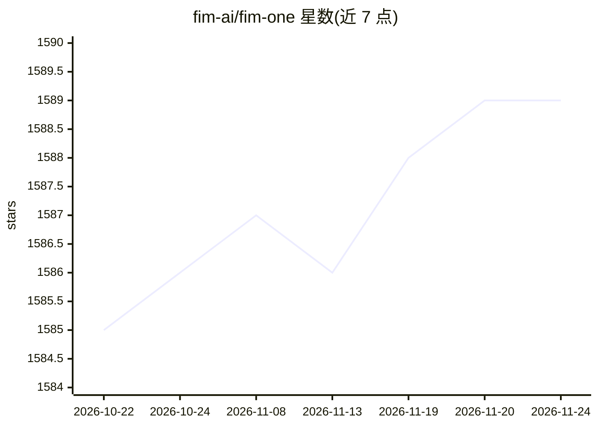

# fim-ai/fim-one

⭐ 1,589 · Python · NOASSERTION · 推送 2026-11-21 · [GitHub](https://github.com/fim-ai/fim-one) · [官网](https://one.fim.ai) · 组织维护 · 中文 README

**面向全球化×中国企业的自托管 Agent 平台：一套核心接入所有系统**

自托管的开源可获取的 Agent 平台，将企业既有系统（ERP、CRM、数据库、IM 等，覆盖全球 SaaS 与中国栈如飞书、WeCom、钉钉、达梦、人大金仓）接入统一 Agent 核心。提供 Standalone/Copilot/Hub 三种交付模式，支持 ReAct 与 LLM 生成的动态 DAG 规划、连接器自动注册为工具、RAG 管线、多租户、Hook 审批系统与评估中心。任何 OpenAI 兼容 LLM 均可接入；Docker 或本地源码运行，前端 Next.js，后端 FastAPI。

## 筛选速览

| 维度 | 判定 | 备注 |
|---|---|---|
| AI 角色 | `ai-ecosystem` | LLM/agent 周边工具 |
| 许可风险 | `none` | NOASSERTION |
| 部署形态 | `self-host` | docker 或自建部署 |
| 模型依赖 | local-ok | 支持本地模型 |
| 硬件要求 | — | 无带数字的原话,不猜 |
| 安装摩擦 | `low` | 无编译、无系统依赖或容器化 |
| 成熟度 | `idea` | |

## 能力要点

- 三种交付模式（Standalone/Copilot/Hub）共用一个 Agent 核心
- 连接器覆盖中国栈数据库（DM、KingbaseES、Highgo）与 IM 平台
- LLM 运行时动态 DAG 规划与 ReAct 双执行模式自动路由
- Hook 系统在 LLM 循环外执行审批/审计/限流

## 适用场景

- 为同时使用全球 SaaS 和中国栈的企业搭建统一 AI 助手
- 将数据库和 API 通过连接器暴露为 Agent 工具
- 对敏感工具调用做人工审批卡片的 IM 集成
- 多租户自托管部署 Agent 平台并计费配额管理

## 场景标签

`AI 助手` `RAG` `Agent 框架` · 领域:Agent 开发

## 证据(README 行号)

> L24: Global enterprises run a sprawl of systems that don't talk to each other — ERP, CRM, OA, HR, finance, databases, IM
> L106: - **Three delivery modes** — Standalone assistant, embedded Copilot, or central Hub; same agent core.
> L164: FIM One works with **any OpenAI-compatible provider**:

## 星数曲线

2026-10-22 1,585 → 2026-11-24 1,589（+4）

---
*卡片 v1 · prompt 1.4 · 生成 2026-11-24 · 置信度 high · 依据 README sha `a26884fb2b09` · [字段定义](../../DATASET.md)*
