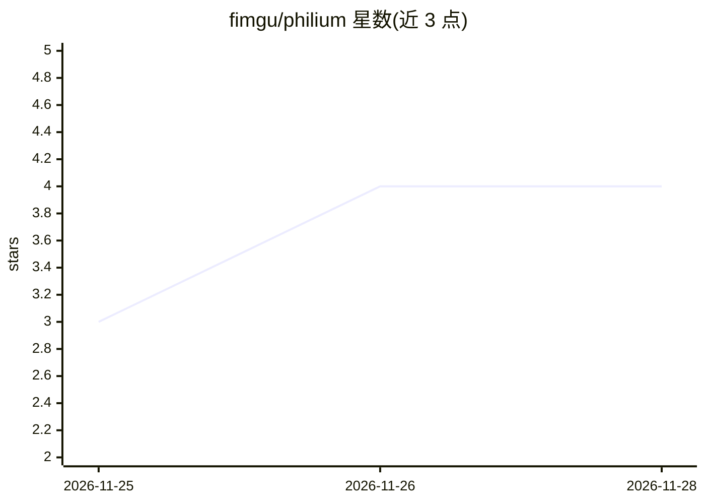

# fimgu/philium

⭐ 4 · Rust · MIT · 推送 2026-11-26 · [GitHub](https://github.com/fimgu/philium) · 个人维护

**在本机运行编码 Agent 的桌面工作区**

基于 Tauri 2 的 macOS 桌面应用，用户添加本地仓库、连接模型服务商后即可在仓库中启动编码 Agent；以结构化时间线展示每条消息、工具调用与模型请求，工具运行前默认请求批准，并监视离开本机的密钥。Agent 运行时是独立项目 HAL，由 Philium 在后台启动；记忆搜索使用设备端本地模型。提供 Board 跨仓库追踪、GitHub CLI 审阅/发布 PR、内建终端与用量统计。

## 筛选速览

| 维度 | 判定 | 备注 |
|---|---|---|
| AI 角色 | `ai-ecosystem` | LLM/agent 周边工具 |
| 许可风险 | `permissive` | MIT |
| 部署形态 | `desktop` | 安装包/桌面程序 |
| 模型依赖 | — | README 未给出锁定关系 |
| 硬件要求 | — | 无带数字的原话,不猜 |
| 安装摩擦 | `low` | 无编译、无系统依赖或容器化 |
| 成熟度 | — | 结构信号不足 |

## 能力要点

- 多个 Agent 跨多个仓库并行运行，单一窗口追踪
- 每次消息、工具调用、模型请求均结构化可见，工具运行前默认批准
- 本地记忆搜索使用设备端模型，监视外发密钥
- 通过 GitHub CLI 审阅 diff 并发布 pull request

## 适用场景

- 在本机同时跑多个编码 Agent 处理不同仓库
- 审阅 Agent 产出的 diff 并直接发布 PR
- 需要查看 Agent 每次工具调用与请求明细的工作流

## 场景标签

`编码 Agent` · 领域:编码与开发

## 证据(README 行号)

> L18: Philium is a desktop workspace for running coding agents on your own machine. You add your repositories, connect a 
> L24: It is built with Tauri 2. The agent runtime is HAL, a separate project that Philium starts in the background and st
> L79: |Setup|One binary|Desktop app plus the HAL runtime|

## 星数曲线

2026-11-25 3 → 2026-11-28 4（+1）

---
*卡片 v1 · prompt 1.4 · 生成 2026-11-24 · 置信度 high · 依据 README sha `b715f5fcd5f2` · [字段定义](../../DATASET.md)*
