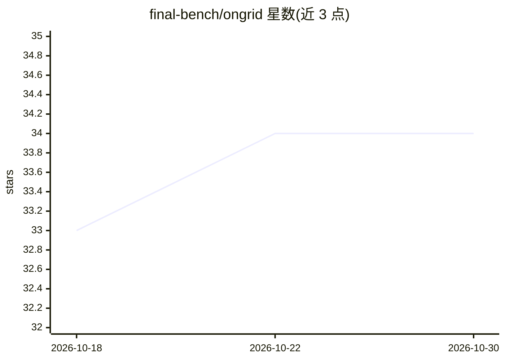

# final-bench/ongrid

⭐ 34 · HTML · Apache-2.0 · 推送 2026-10-14 · [GitHub](https://github.com/final-bench/ongrid) · [官网](https://huggingface.co/spaces/FINAL-Bench/ONGRID) · 组织维护 · 中文 README

**3D 本体知识图谱 GraphRAG 引擎，附零 token 答案真伪判定**

ONGRID 将上传文档解析为带类型实体与关系的本体图谱，以 three.js 渲染为 3D 可交互知识宇宙；提问时按 GraphRAG 检索相关图事实，LLM 仅基于检索事实生成回答并展示证据，随后由 FINAL-Bench ZTC-Judge 模型在单次前向传播（零生成 token）中输出答案可信度判定。文档解析在浏览器本地完成，不上传文件。提供韩/英/中三语界面，Apache-2.0 许可，通过 Docker 部署，需配置 ANTHROPIC_API_KEY；ZTC-Judge 有 4B/9B/27B 型号，大模型版本需 GPU。

## 筛选速览

| 维度 | 判定 | 备注 |
|---|---|---|
| AI 角色 | `ai-ecosystem` | LLM/agent 周边工具 |
| 许可风险 | `permissive` | Apache-2.0 |
| 部署形态 | `self-host` | docker 或自建部署 |
| 模型依赖 | — | README 未给出锁定关系 |
| 硬件要求 | — | 无带数字的原话,不猜 |
| 安装摩擦 | `low` | 无编译、无系统依赖或容器化 |
| 成熟度 | — | 结构信号不足 |

## 能力要点

- 文档→类型化实体与关系→3D 本体图谱的自动构建与渲染
- GraphRAG 检索后 LLM 仅基于图事实回答并展示证据
- ZTC-Judge 单次前向传播完成零 token 答案可信判定
- 浏览器本地解析上传文档（.md/.txt/.json/.csv），文件不上传

## 适用场景

- 把自己的文档构建成 3D 知识图谱并做有据问答
- 对 RAG 回答附加可信度判定，识别不可信答案
- 在本地/私有环境部署带答案验证的知识检索系统

## 场景标签

`文档解析` `知识图谱` `RAG` `文档问答` · 领域:知识与检索

## 证据(README 行号)

> L23: > **ONGRID in one line:** an open **ontology graph + <abbr title="Graph-based Retrieval-Augmented Generation.">Grap
> L33: |**I**|Inference|An LLM answers **only from those facts**|LLM API|
> L34: |**D**|**Decision**|**ZTC-Judge scores if the answer is trustworthy — 0 generated tokens**|FINAL-Bench ZTC-Judge|

## 星数曲线

2026-10-18 33 → 2026-10-30 34（+1）

---
*卡片 v1 · prompt 1.4 · 生成 2026-10-25 · 置信度 high · 依据 README sha `6480512f9d90` · [字段定义](../../DATASET.md)*
