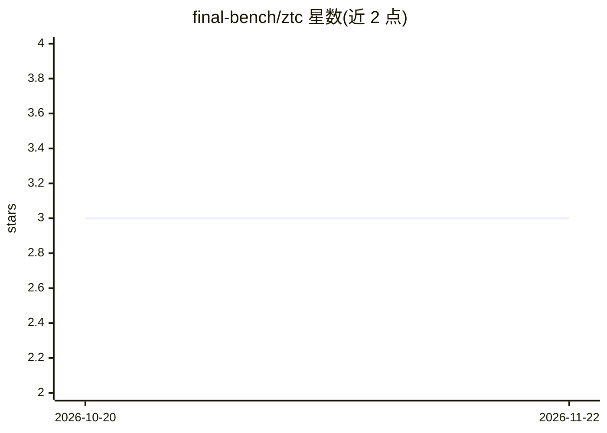

# final-bench/ztc

⭐ 3 · Python · Apache-2.0 · 推送 2026-10-09 · [GitHub](https://github.com/final-bench/ztc) · [官网](https://huggingface.co/FINAL-Bench) · 组织维护

**零生成 token 的 LLM 答案可信度校验器，供开发者在生产中核验回答**

ZTC 读取任意模型产生的问题与答案，在单次前向传播中取末层隐状态并施加校准探针，返回 trust 分数与裁决（无需生成任何 token），输出确定性且成本低到可逐条核验。仓库包含推理代码（ztc_judge.py 线性探针、usage_curve.py 曲线探针）与模型索引，权重托管在 Hugging Face；训练语料与探针拟合流程不在仓库内。模型族分两线：ZTC-Judge 核验他人答案（4B/9B/27B，4B 可在 CPU 运行），Darwin-ZTC 处理 typed decisions 并在 S1MB 上以 102 个模型中排名第一。适用于考试、生物与科学推理等校准过的领域，领域外分数应作排序信号使用。

## 筛选速览

| 维度 | 判定 | 备注 |
|---|---|---|
| AI 角色 | `ai-native` | 本体是模型或模型工具 |
| 许可风险 | `permissive` | Apache-2.0 |
| 部署形态 | `None` |  |
| 模型依赖 | — | README 未给出锁定关系 |
| 硬件要求 | `cpu-ok` | |
| 安装摩擦 | `low` | 无编译、无系统依赖或容器化 |
| 成熟度 | — | 结构信号不足 |

## 能力要点

- 单次前向传播返回 trust 分数，生成 token 数为 0，无采样故输出确定
- ZTC-Judge-4B 可在无 GPU 的 CPU 上运行
- 探针采用 leave-one-domain-out 拟合，报告数字来自探针未见过的领域
- 模型权重托管在 Hugging Face，含 4B/9B/27B/397B 多档

## 适用场景

- 对生产环境中 LLM 的每条回答做可信度核验
- 替代逐 token 生成式 critique 的 LLM-as-a-judge 流程
- 为答案提供 review / clear 阈值的分流判断

## 场景标签

`模型评测` · 领域:评测与运维

## 证据(README 行号)

> L14: **ZTC (Zero-Token Confidence)** reads a question and an answer written by any model and returns whether that answer
> L29: Two lines: **ZTC-Judge** verifies someone else's answer (question + answer -> trust). **Darwin-ZTC** scores typed d

## 星数曲线

2026-10-20 3 → 2026-11-22 3（+0）

---
*卡片 v1 · prompt 1.4 · 生成 2026-11-22 · 置信度 high · 依据 README sha `f105b836a7bc` · [字段定义](../../DATASET.md)*
