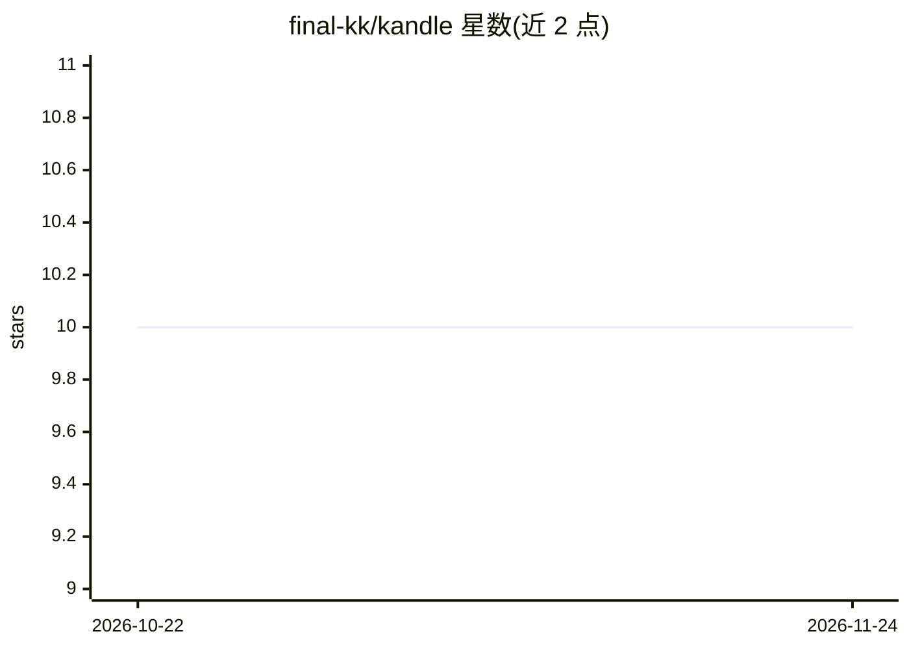

# final-kk/kandle

⭐ 10 · TypeScript · MIT · 推送 2026-01-30 · [GitHub](https://github.com/final-kk/kandle) · [官网](http://kandle-demo.vercel.app/) · 个人维护 · 中文 README

**给 JavaScript 开发者的 PyTorch 风格 ML 框架，基于 WebGPU**

Kandle 是一个 JavaScript 原生的机器学习框架，采用 Eager Mode（动态图）执行，架构层面参考 PyTorch 的 ATen/c10 设计，在统一接口下支持 WebGPU（GPU 加速）与纯 JS（CPU）双后端。内置完整张量系统（stride、广播、零拷贝视图）与 200+ 算子，原生支持 Qwen3、Whisper 模型并可加载 Safetensors 权重。README 声明当前为技术验证原型，仅验证前向传播，Autograd 尚在开发中，暂不接受 PR，不适用于高性能生产推理。

## 筛选速览

| 维度 | 判定 | 备注 |
|---|---|---|
| AI 角色 | `ai-native` | 本体是模型或模型工具 |
| 许可风险 | `permissive` | MIT |
| 部署形态 | `library` | 以包/库形式分发 |
| 模型依赖 | — | README 未给出锁定关系 |
| 硬件要求 | — | 无带数字的原话,不猜 |
| 安装摩擦 | `medium` | 含编译或系统依赖之一 |
| 成熟度 | `idea` | |

## 能力要点

- Eager Mode 动态图执行，支持逐层调试、hook 与中间状态导出
- WebGPU 与纯 JS 双后端，统一接口
- 200+ 张量算子，完整 stride/广播/零拷贝视图机制
- 原生支持 Qwen3 与 Whisper，可直接加载 Safetensors 权重

## 适用场景

- 在浏览器中跑通并逐步剖析 Qwen3/Whisper 的前向传播过程
- 研究模型可解释性：逐层提取张量、可视化注意力热力图
- 以 PyTorch API 习惯构建和调试 JS 侧机器学习原型

## 场景标签

`推理引擎` · 领域:训练与推理

## 证据(README 行号)

> L13: Kandle is a **JavaScript Native** machine learning framework that adopts an **Eager Mode** (dynamic graph) executio
> L19: * **⚡ Hybrid Backend Architecture**: Supports both WebGPU (GPU acceleration) and pure JS (CPU computation) backends
> L22: * **🚀 Out-of-the-Box Models**: Native support for mainstream models like Qwen3 and Whisper, capable of loading Safe

## 星数曲线

2026-10-22 10 → 2026-11-24 10（+0）

---
*卡片 v1 · prompt 1.4 · 生成 2026-11-19 · 置信度 high · 依据 README sha `e8ceb6586804` · [字段定义](../../DATASET.md)*
