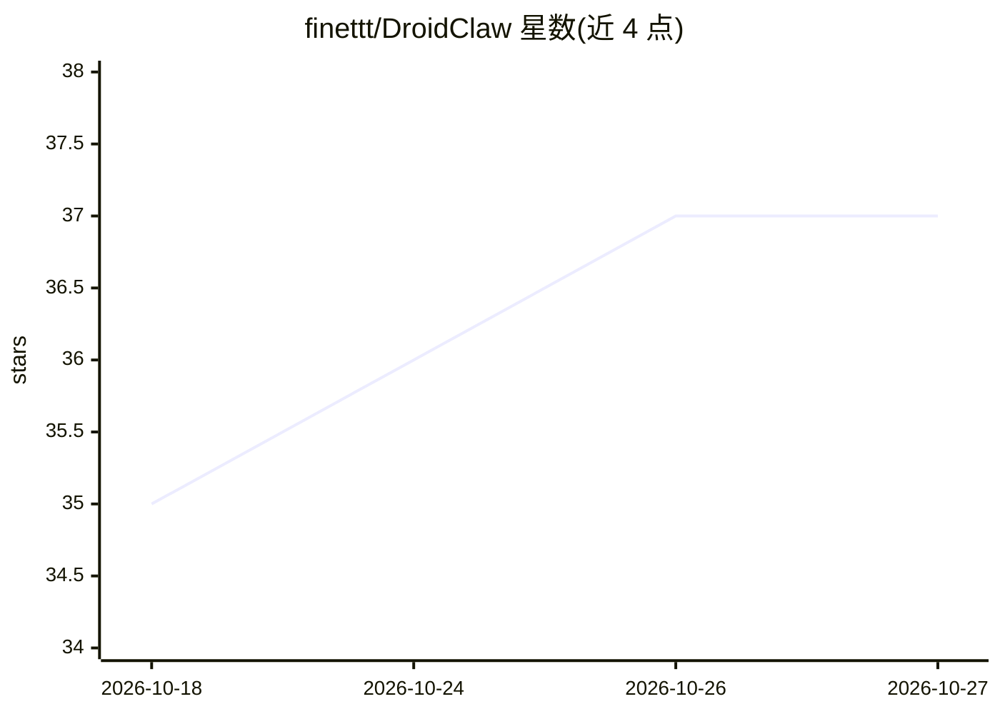

# finettt/DroidClaw

⭐ 37 · Java · 推送 2026-10-10 · [GitHub](https://github.com/finettt/DroidClaw) · [官网](https://finett.undo.it/droidclaw) · 个人维护

**无 root 的 Android 原生个人 AI 助手应用**

以原生 Android/Java 实现的个人 AI 助手，安装包约 48MB，内嵌 Python 3.11 解释器，无需 Node.js 与 root。支持 OpenAI、Anthropic、OpenRouter、Moonshot、Fireworks、Llama.cpp、vLLM 等多种 API 提供方接入。Agent 能力包括沙箱内执行 Python 与 shell（可经 SSH 走远程主机）、文件管理、设备控制（点按/滑动/读 UI 树）、日历读写与多子代理 workflows。作者声明为教育项目、不与 OpenClaw 竞争。安装方式为 releases 页下载或自行克隆构建。

## 筛选速览

| 维度 | 判定 | 备注 |
|---|---|---|
| AI 角色 | `ai-native` | 本体是模型或模型工具 |
| 许可风险 | `none` | — |
| 部署形态 | `desktop` | 安装包/桌面程序 |
| 模型依赖 | — | README 未给出锁定关系 |
| 硬件要求 | — | 无带数字的原话,不猜 |
| 安装摩擦 | `medium` | 含编译或系统依赖之一 |
| 成熟度 | — | 结构信号不足 |

## 能力要点

- 无需 root，约 48MB 包体且内嵌 Python 3.11
- 沙箱文件系统中执行 Python 与 shell（本地或 SSH 远程）
- 设备控制：列开应用、点按/滑动/输入/读 UI 树
- Workflows：单个请求分发给多个限定工具的子代理

## 适用场景

- 在没有服务器硬件时把手机变成个人 AI 代理
- 通过对话让代理操作手机应用、日历与文件
- 在沙箱中让代理执行 Python 脚本或经 SSH 管理远程主机

## 场景标签

`AI 助手` `GUI 自动化` · 领域:效率与自动化

## 证据(README 行号)

> L10: **DroidClaw** is a personal AI assistant that runs on your phone **without root**, as a native Android/Java app. Yo
> L14: You can connect any provider/model to the app. It supports both the OpenAI and Anthropic APIs, so you can easily st

## 星数曲线

2026-10-18 35 → 2026-10-27 37（+2）

---
*卡片 v1 · prompt 1.4 · 生成 2026-10-25 · 置信度 high · 依据 README sha `aa2b306efea0` · [字段定义](../../DATASET.md)*
