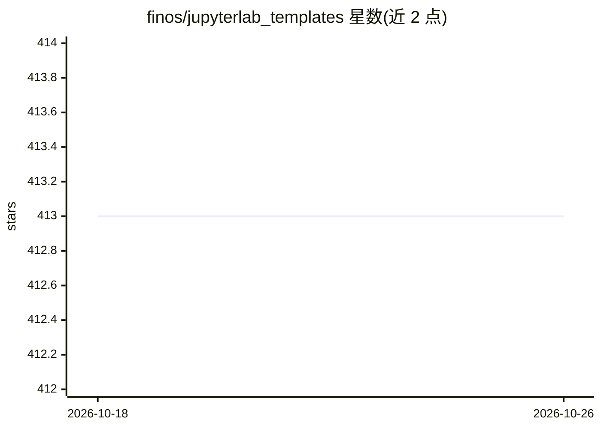

# finos/jupyterlab_templates

⭐ 413 · JavaScript · Apache-2.0 · 推送 2026-10-01 · [GitHub](https://github.com/finos/jupyterlab_templates) · 组织维护

**JupyterLab 笔记本模板扩展：从指定目录加载模板供选用**

FINOS 毕业项目，为 JupyterLab 提供笔记本模板功能的 server/lab 扩展。安装后在 JupyterLab 界面出现 Template 入口，读取配置的模板目录，将其子目录中匹配允许扩展名（默认 *.ipynb）的笔记本列为可选模板。通过 jupyter_notebook_config.py 配置模板目录、允许扩展名、是否包含默认模板与 jupyter 核心路径、UI 标签等；支持 .jupyterlab_templates_ignore 文件排除目录。可经 pip、conda-forge 或 labextension 命令安装。

## 筛选速览

| 维度 | 判定 | 备注 |
|---|---|---|
| AI 角色 | `ai-ecosystem` | LLM/agent 周边工具 |
| 许可风险 | `permissive` | Apache-2.0 |
| 部署形态 | `library` | 以包/库形式分发 |
| 模型依赖 | — | README 未给出锁定关系 |
| 硬件要求 | — | 无带数字的原话,不猜 |
| 安装摩擦 | `low` | 无编译、无系统依赖或容器化 |
| 成熟度 | — | 结构信号不足 |

## 能力要点

- 在 JupyterLab 中列出并选用笔记本模板
- 可配置模板目录、允许扩展名、默认模板与核心路径
- 支持 .jupyterlab_templates_ignore 排除特定目录
- 经 pip / conda-forge / labextension 三种方式安装

## 适用场景

- 团队为数据科学笔记本统一提供起始模板
- 库作者向用户分发教程或示例笔记本模板
- 机构标准化 notebook 编写规范

## 场景标签

 · 领域:数据科学/开发工具

## 证据(README 行号)

> L3: Support for jupyter notebook templates in jupyterlab

## 星数曲线

2026-10-18 413 → 2026-10-26 413（+0）

---
*卡片 v1 · prompt 1.4 · 生成 2026-10-21 · 置信度 mid · 依据 README sha `c5eb15ffb842` · [字段定义](../../DATASET.md)*
