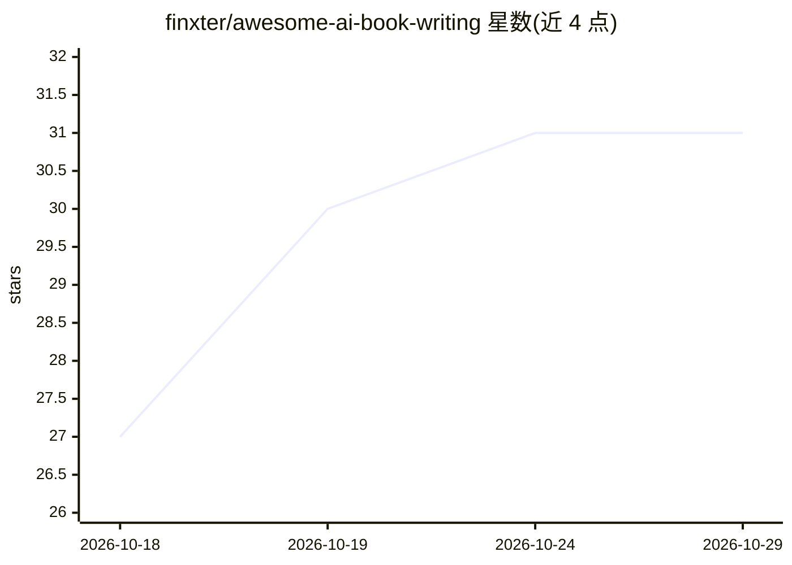

# finxter/awesome-ai-book-writing

⭐ 31 · 推送 2026-10-14 · [GitHub](https://github.com/finxter/awesome-ai-book-writing) · [官网](https://www.imagineyourbook.com/) · 个人维护

**面向长篇书籍创作的 AI 工具与工作流策展清单**

由个人维护的 awesome list，收录撰写、编辑与出版完整书籍所用的 AI 工具与资源：覆盖整本生成、小说写作助手、通用模型、故事圣经与系列连续性、大纲结构、编辑、封面、排版出版、市场研究、有声书旁白、AI 检测与披露等类别，每条目附一句话用途说明，维护者以 ⭐ 标注个人日常使用的工具。另提供按瓶颈场景的工具选择表、若干创作工作流模式（分块起草、每章重注入风格锚点等）及相关清单链接。许可为 CC0。

## 筛选速览

| 维度 | 判定 | 备注 |
|---|---|---|
| AI 角色 | `ai-knowledge` | 知识聚合/清单类 |
| 许可风险 | `none` | — |
| 部署形态 | `None` |  |
| 模型依赖 | — | README 未给出锁定关系 |
| 硬件要求 | — | 无带数字的原话,不猜 |
| 安装摩擦 | `low` | 无编译、无系统依赖或容器化 |
| 成熟度 | — | 结构信号不足 |

## 能力要点

- 按创作环节分类的工具清单（生成/助手/连续性/编辑/出版等）
- 每条目附一句话用途说明，⭐ 标注维护者日常使用工具
- 按瓶颈场景的工具选择表与多条创作工作流建议

## 适用场景

- 写长篇小说时寻找分环节的 AI 工具
- 解决跨章节人物设定与风格漂移问题
- 自助出版作者选择排版、封面与市场研究工具

## 场景标签

`AI 写作` `精选清单` · 领域:内容生成

## 证据(README 行号)

> L1: # Awesome AI Book Writing Awesome
> L3: > A curated list of AI tools, workflows and resources for writing, editing and publishing full-length books.
> L5: Most "AI writing" lists are marketing-copy tools with a novel-shaped hole in the middle. This one is only about **bo

## 星数曲线

2026-10-18 27 → 2026-10-29 31（+4）

---
*卡片 v1 · prompt 1.4 · 生成 2026-10-26 · 置信度 high · 依据 README sha `79f24bfa3c4b` · [字段定义](../../DATASET.md)*
