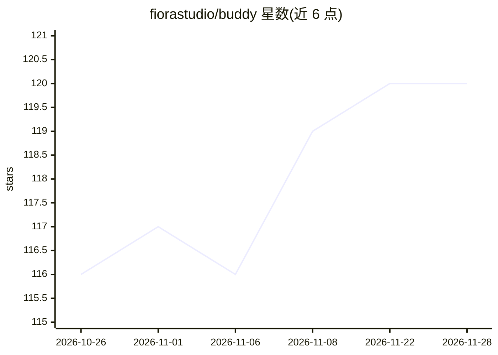

# fiorastudio/buddy

⭐ 120 · TypeScript · MIT · 推送 2026-11-27 · [GitHub](https://github.com/fiorastudio/buddy) · 组织维护

**为 AI 编码 CLI 提供持久化虚拟宠物同伴与代码评审反馈**

以 MCP server 形式运行的本地伴侣工具：在 Claude Code、Codex、Gemini、Copilot、Cursor 等 CLI 客户端中提供一只虚拟宠物，具有 21 种物种、5 项属性、心情系统、XP 升级与 SQLite 持久化记忆。核心机制 Guard Mode 由宿主 LLM 抽取对话中的声明并构建本地有向图，按认识论基础类型与边类型检测 6 种推理模式并给出提示；数据全部留在本地 `~/.buddy/buddy.db`，30 天自动清理。安装脚本自动配置支持的客户端。

## 筛选速览

| 维度 | 判定 | 备注 |
|---|---|---|
| AI 角色 | `ai-ecosystem` | LLM/agent 周边工具 |
| 许可风险 | `permissive` | MIT |
| 部署形态 | `library` | 以包/库形式分发 |
| 模型依赖 | — | README 未给出锁定关系 |
| 硬件要求 | — | 无带数字的原话,不猜 |
| 安装摩擦 | `low` | 无编译、无系统依赖或容器化 |
| 成熟度 | — | 结构信号不足 |

## 能力要点

- MCP server 跨客户端持久化伴侣（SQLite 存储，跨会话存活）
- Guard Mode 构建本地声明图并检测 6 种推理模式（caution/kudos 提示）
- 21 种物种、5 属性、心情与 XP 升级系统
- 安装脚本自动配置已检测 CLI 客户端的 MCP、hooks 与 statusline

## 适用场景

- 在终端 AI 编码助手中获得带个性的代码评审反馈
- 让 AI 会话中的未验证假设被提醒检查
- 跨多个 CLI 客户端保持同一伴侣状态与记忆
- 通过 OpenClaw 把伴侣接入 WhatsApp/Telegram 工作流

## 场景标签

`代码审查` · 领域:编码与开发

## 证据(README 行号)

> L5: Persistent memory, XP evolutions, 21 species, and context-aware feedback for Claude Code CLI, Codex CLI, Gemini CLI,
> L63: - **Works across clients and chat surfaces.** Buddy is an MCP server, not a one-client hack, and it can ride throug

## 星数曲线

2026-10-26 116 → 2026-11-28 120（+4）

---
*卡片 v1 · prompt 1.4 · 生成 2026-11-28 · 置信度 mid · 依据 README sha `74773be1786a` · [字段定义](../../DATASET.md)*
