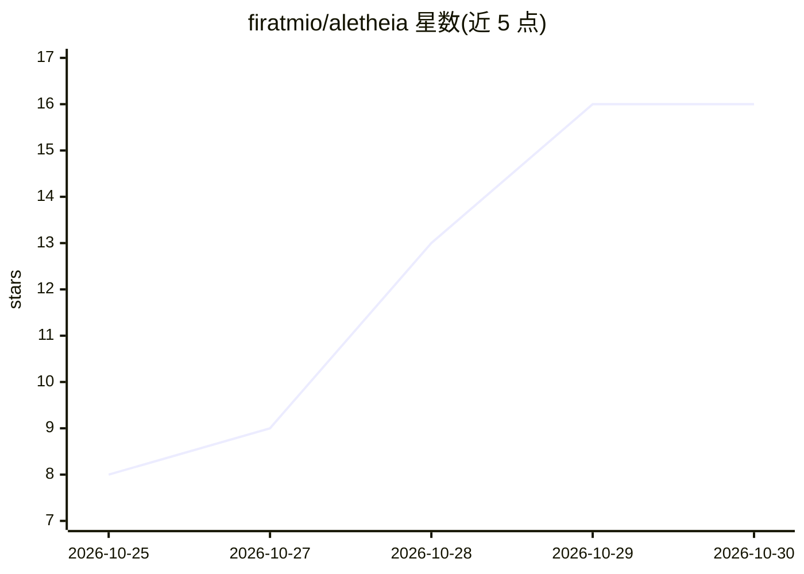

# firatmio/aletheia

⭐ 16 · Go · Apache-2.0 · 推送 2026-10-25 · [GitHub](https://github.com/firatmio/aletheia) · [官网](https://aletheia.firattunaarslan.me) · 个人维护

**面向编码 agent 的可验证记忆服务器，记忆附代码证据**

以 MCP 服务器与 CLI 双形态提供的编码 agent 记忆层：每条记忆是声明加锚点（symbol/contains/exists/file），每次召回时机械地重新核对代码证据，证据失效的记忆被隐藏并给出说明；Go 声明移动后可通过指纹封印以 [moved] 追回。附带代码地图（列出文件与声明的当前行号）与任务结束后自动记录变更文件的自写地图机制。记忆以纯 Markdown 存于 .aletheia/memories/，可提交共享。核对过程无模型调用、无嵌入、无网络。提供 Claude Code 插件，其他 agent 经 MCP 或 CLI 接入。

## 筛选速览

| 维度 | 判定 | 备注 |
|---|---|---|
| AI 角色 | `ai-ecosystem` | LLM/agent 周边工具 |
| 许可风险 | `permissive` | Apache-2.0 |
| 部署形态 | `desktop` | 安装包/桌面程序 |
| 模型依赖 | locked-api |  |
| 硬件要求 | — | 无带数字的原话,不猜 |
| 安装摩擦 | `low` | 无编译、无系统依赖或容器化 |
| 成熟度 | — | 结构信号不足 |

## 能力要点

- 每条记忆携带锚点证据，每次召回机械核对，失效记忆被隐藏
- Go 声明指纹封印，代码移动后记忆以 [moved] 追回新位置
- 代码地图与自写地图：按主题列出文件与声明的当前行号
- 记忆为纯 Markdown 文件，可提交版本库团队共享

## 适用场景

- 让编码 agent 跨会话记住项目事实且不被过时记忆误导
- 团队通过提交 .aletheia/memories 共享一套可自验证的记忆
- 在大型代码库中让 agent 直接定位到相关声明的具体行

## 场景标签

`Agent 记忆` · 领域:Agent 开发

## 证据(README 行号)

> L159: Aletheia speaks MCP over stdio with four tools (`recall`, `remember`, `get`, `verify`) and works as a plain CLI, s
> L33: - **Memories carry evidence.** Each memory is a claim plus anchors: a function that must still exist, a line that m

## 星数曲线

2026-10-25 8 → 2026-10-30 16（+8）

---
*卡片 v1 · prompt 1.4 · 生成 2026-10-30 · 置信度 high · 依据 README sha `83f433a97d28` · [字段定义](../../DATASET.md)*
