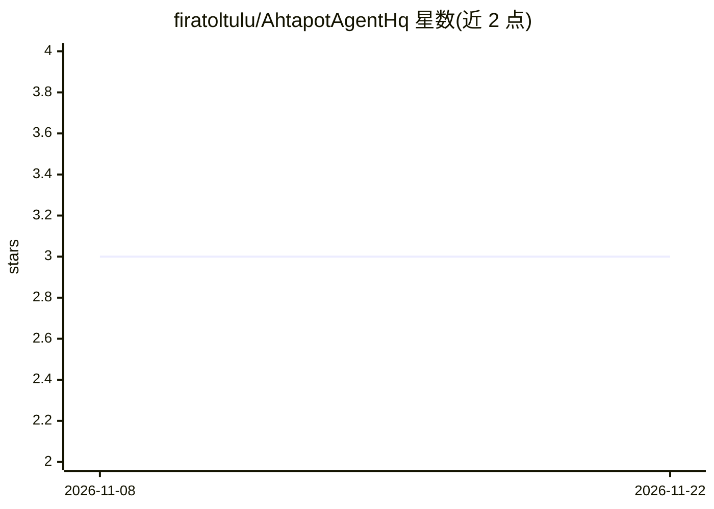

# firatoltulu/AhtapotAgentHq

⭐ 3 · TypeScript · 推送 2026-11-02 · [GitHub](https://github.com/firatoltulu/AhtapotAgentHq) · 个人维护

**多 Agent 开发编排器：从规划到 QA、PR、CI 全流程**

以 TypeScript 编写的多 Agent 开发编排系统，流程覆盖 Analyst 分析、Planner 规划、Developer 开发、QA 测试、PR 与 CI 跟进。每个 Agent 在独立 Docker sandbox 容器中运行，目标项目通过 profile 机制从外部接入，运行中可与 Agent 实时对话并修改方向。需 Claude Pro/Max 订阅 token 或 API key，支持多 key 池轮换；无 Docker 时仅能使用部分界面，开发与实况环境步骤不可用。

## 筛选速览

| 维度 | 判定 | 备注 |
|---|---|---|
| AI 角色 | `ai-ecosystem` | LLM/agent 周边工具 |
| 许可风险 | `none` | — |
| 部署形态 | `self-host` | docker 或自建部署 |
| 模型依赖 | locked-api |  |
| 硬件要求 | — | 无带数字的原话,不猜 |
| 安装摩擦 | `low` | 无编译、无系统依赖或容器化 |
| 成熟度 | — | 结构信号不足 |

## 能力要点

- Planner→Developer→QA→PR→CI 的多 Agent 流水线编排
- Agent 运行中实时对话：对计划提异议、在浏览器实测实况环境
- 每个 Agent 独立 Docker sandbox 容器，worktree 以命名 volume 保存
- 多 Claude key 池：触发配额的 key 进入冷却，任务换下一把继续

## 适用场景

- 在统一编排下让多个 Agent 完成开发到 PR 的完整流程
- 对接 GitHub issue 生成任务并跟踪 CI 结果
- 通过 profile 为不同技术栈项目定义各自的构建与测试纪律

## 场景标签

`编码 Agent` `多智能体` · 领域:Agent 开发

## 证据(README 行号)

> L3: Çok-agent'lı, **canlı etkileşimli** geliştirme orkestratörü.
> L49: **Docker neden zorunlu?** Her agent kendi sandbox konteynerinde koşar; canlı
> L18: Proje-agnostik: hedef proje dışarıdan bağlanır ve kendi çalışma disiplinini

## 星数曲线

2026-11-08 3 → 2026-11-22 3（+0）

---
*卡片 v1 · prompt 1.4 · 生成 2026-11-22 · 置信度 high · 依据 README sha `7e1f7ee3b0b7` · [字段定义](../../DATASET.md)*
