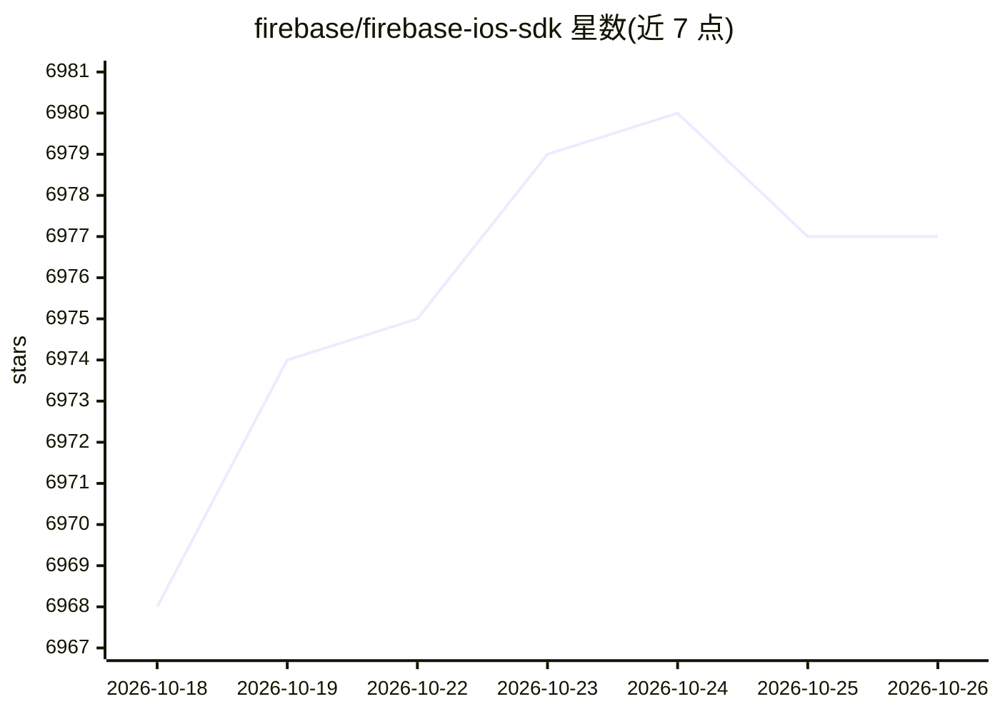

# firebase/firebase-ios-sdk

⭐ 6,977 · C++ · Apache-2.0 · 推送 2026-10-25 · [GitHub](https://github.com/firebase/firebase-ios-sdk) · [官网](https://firebase.google.com) · 组织维护

**面向 Apple 平台开发者的 Firebase 官方 SDK 源码库**

Google Firebase 的 Apple 平台 SDK 开源仓库，包含除 FirebaseAnalytics 外全部产品库的源码：AI Logic、Authentication、Cloud Firestore、Cloud Messaging、Crashlytics、Realtime Database、Remote Config、Storage 等 13 个模块；Analytics 本体闭源但以预编译二进制随包分发。供 iOS/macOS/Catalyst/tvOS 应用开发者集成，visionOS 与 watchOS 为社区支持。提供 Swift Package Manager、CocoaPods、GitHub 源码及 Carthage（实验性）安装方式；CocoaPods 分发将于 2026 年 10 月后停止发布新版本。

## 筛选速览

| 维度 | 判定 | 备注 |
|---|---|---|
| AI 角色 | `ai-enhanced` | 去掉 AI 部分产品仍成立 |
| 许可风险 | `permissive` | Apache-2.0 |
| 部署形态 | `None` |  |
| 模型依赖 | — | README 未给出锁定关系 |
| 硬件要求 | — | 无带数字的原话,不猜 |
| 安装摩擦 | `low` | 无编译、无系统依赖或容器化 |
| 成熟度 | `idea` | |

## 能力要点

- 13 个开源 Firebase 产品库源码（AI Logic、Firestore、Crashlytics 等）
- Firebase AI Logic 的 Gemini Foundation Models 适配器处于 preview 阶段
- macOS/Catalyst/tvOS 官方 beta 支持，visionOS/watchOS 社区支持
- FirebaseCombineSwift 提供对 Apple Combine 框架的支持（开发中）

## 适用场景

- 在 iOS/macOS 应用中集成 Firebase 后端服务（认证、数据库、存储等）
- 通过 Firebase AI Logic 在 Apple 应用中接入 AI 模型
- 采集应用崩溃与性能数据（Crashlytics、Performance Monitoring）

## 场景标签

`模型网关` · 领域:Agent 开发

## 证据(README 行号)

> L42: * Firebase AI Logic (`FirebaseAI`)
> L25: > **Preview Release:** Firebase AI Logic's Gemini Foundation Models framework

## 星数曲线

2026-10-18 6,968 → 2026-10-26 6,977（+9）

---
*卡片 v1 · prompt 1.4 · 生成 2026-10-20 · 置信度 high · 依据 README sha `368879878896` · [字段定义](../../DATASET.md)*
