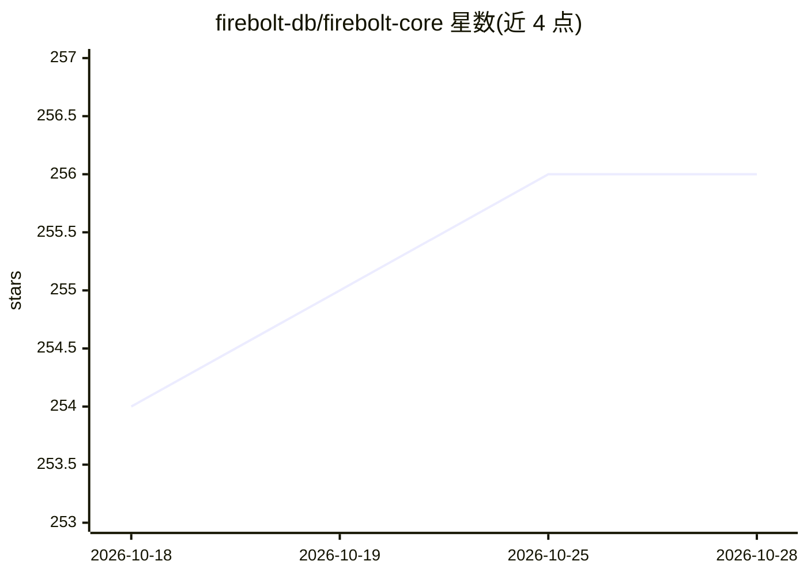

# firebolt-db/firebolt-core

⭐ 256 · Shell · NOASSERTION · 推送 2026-10-26 · [GitHub](https://github.com/firebolt-db/firebolt-core) · [官网](https://firebolt.io/core) · 组织维护

**自托管的 Firebolt 分布式数据仓库查询引擎（免费版）**

Firebolt Core 是 Firebolt 商业云数仓的自托管免费版本，提供分布式查询执行引擎、查询优化器与 Iceberg 支持，SQL 方言与 Postgres 兼容并附带数组处理 lambda 函数等分析扩展。以单一 Docker 镜像交付，可单机部署（curl 安装脚本或 docker run），也支持 Docker Compose 多节点与 Kubernetes 部署。通过 cURL、CLI 或 Web UI 提交 SQL 查询。要求 Linux 内核 ≥6.1（使用 io_uring），每节点建议 16 GB 内存与 25 GB SSD。

## 筛选速览

| 维度 | 判定 | 备注 |
|---|---|---|
| AI 角色 | `ai-ecosystem` | LLM/agent 周边工具 |
| 许可风险 | `none` | NOASSERTION |
| 部署形态 | `self-host` | docker 或自建部署 |
| 模型依赖 | — | README 未给出锁定关系 |
| 硬件要求 | — | 无带数字的原话,不猜 |
| 安装摩擦 | `low` | 无编译、无系统依赖或容器化 |
| 成熟度 | — | 结构信号不足 |

## 能力要点

- Firebolt 托管数仓的自托管免费版，无用量限制
- Postgres 兼容 SQL 方言，支持 Iceberg
- 单 Docker 镜像交付，支持单机、Docker Compose 多节点与 Kubernetes
- 可通过 cURL、firebolt CLI 与 Web UI 提交查询

## 适用场景

- 在自有服务器或 VPC 内搭建数据仓库做大规模分析
- 替代托管云数仓处理实时与嵌入式分析负载
- 从笔记本到集群按需弹性扩展查询节点

## 场景标签

 · 领域:数据库/数据分析

## 证据(README 行号)

> L2:  Firebolt Core is a free, self-hosted edition of Firebolt's high-performance distributed query engine, designed to p
> L31: * 🤖 **AI-ready architecture** optimized for modern data and ML applications.
> L32: * 🎯 **Designed for demanding applications.** Powering real-time analytics, embedded analytics, and large-scale data

## 星数曲线

2026-10-18 254 → 2026-10-28 256（+2）

---
*卡片 v1 · prompt 1.4 · 生成 2026-10-22 · 置信度 high · 依据 README sha `6c2807689c9a` · [字段定义](../../DATASET.md)*
