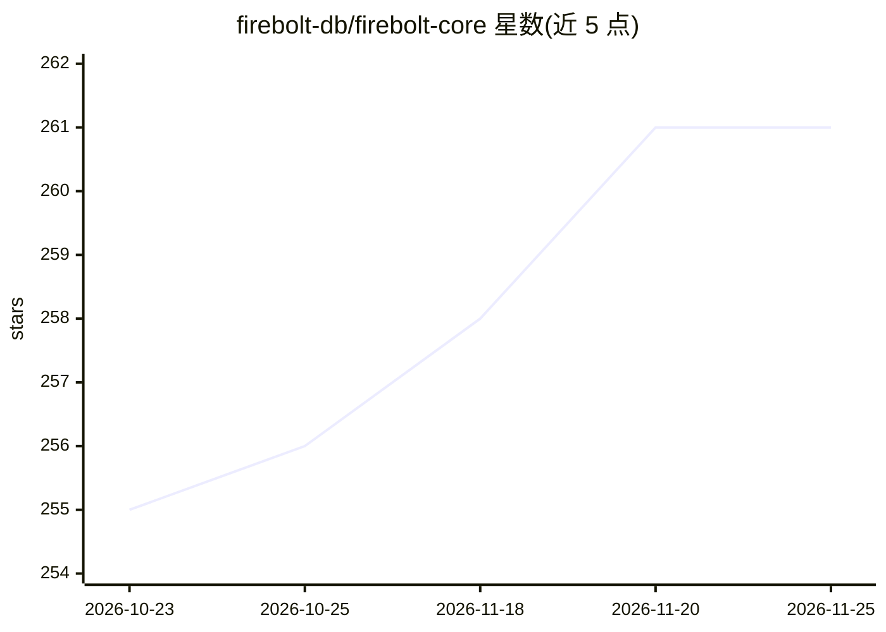

# firebolt-db/firebolt-core

⭐ 261 · Shell · NOASSERTION · 推送 2026-11-23 · [GitHub](https://github.com/firebolt-db/firebolt-core) · [官网](https://firebolt.io/core) · 组织维护

**给数据分析团队的自托管分布式查询引擎**

Firebolt 托管云数仓的自托管免费版本，以单个 Docker 镜像分发，可在笔记本到多节点集群部署。SQL 方言与 Postgres 兼容并提供分析扩展（如数组 lambda 函数），支持 Iceberg 表格式；单节点或多节点（Docker Compose/Kubernetes）部署均可，README 给出 16 GB 内存、25 GB SSD、Linux 内核 ≥6.1（io_uring）等运行要求，并通过 HTTP/CLI/Web UI 三种方式提交查询。

## 筛选速览

| 维度 | 判定 | 备注 |
|---|---|---|
| AI 角色 | `ai-enhanced` | 去掉 AI 部分产品仍成立 |
| 许可风险 | `none` | NOASSERTION |
| 部署形态 | `self-host` | docker 或自建部署 |
| 模型依赖 | — | README 未给出锁定关系 |
| 硬件要求 | — | 无带数字的原话,不猜 |
| 安装摩擦 | `low` | 无编译、无系统依赖或容器化 |
| 成熟度 | — | 结构信号不足 |

## 能力要点

- 打包为单个 Docker 镜像，自托管部署无使用量限制
- Postgres 兼容 SQL 方言，含数组 lambda 等分析扩展
- 支持单节点到多节点（Docker Compose/Kubernetes）部署
- 提供容器内 CLI、HTTP 客户端与 Web UI 查询入口

## 适用场景

- 在自有数据中心或工作站搭建分析型数据仓库
- 对 Parquet/Iceberg 数据做交互式 SQL 分析
- 部署多节点集群处理大规模数据查询

## 场景标签

 · 领域:数据库/数据分析

## 证据(README 行号)

> L2:  Firebolt Core is a free, self-hosted edition of Firebolt's high-performance distributed query engine, designed to p
> L28: * 🛠️ **Self-contained.** Firebolt Core comes packaged as a single Docker image (`ghcr.io/firebolt-db/engine:dev`) t
> L31: * 🤖 **AI-ready architecture** optimized for modern data and ML applications.

## 星数曲线

2026-10-23 255 → 2026-11-25 261（+6）

---
*卡片 v1 · prompt 1.4 · 生成 2026-11-25 · 置信度 high · 依据 README sha `2381a0722aa1` · [字段定义](../../DATASET.md)*
