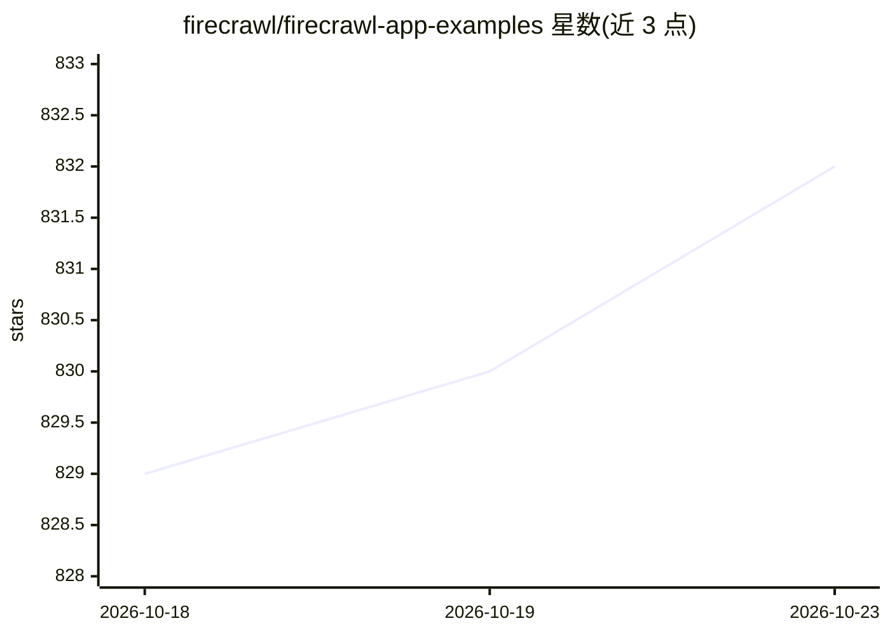

# firecrawl/firecrawl-app-examples

⭐ 832 · Jupyter Notebook · 推送 2026-01-13 · [GitHub](https://github.com/firecrawl/firecrawl-app-examples) · [官网](https://www.firecrawl.dev/) · 组织维护

**Firecrawl 构建的完整应用示例集合**

收录使用 Firecrawl 开发的完整应用示例（含网站等项目），用于演示 Firecrawl 的多种实现方式与使用场景。每个示例为独立项目目录，各自带 README 说明配置与运行方法；使用方式为克隆仓库后进入对应示例目录按其说明安装运行。仓库本身不提供统一安装流程或可直接运行的单一产品。

## 筛选速览

| 维度 | 判定 | 备注 |
|---|---|---|
| AI 角色 | `ai-knowledge` | 知识聚合/清单类 |
| 许可风险 | `none` | — |
| 部署形态 | `None` |  |
| 模型依赖 | — | README 未给出锁定关系 |
| 硬件要求 | — | 无带数字的原话,不猜 |
| 安装摩擦 | `low` | 无编译、无系统依赖或容器化 |
| 成熟度 | — | 结构信号不足 |

## 能力要点

- 收录基于 Firecrawl 的完整应用示例项目
- 每个示例目录含各自的 README 配置与运行说明
- 覆盖网站等多种项目形式的实现演示

## 适用场景

- 查找 Firecrawl 的实际应用示例作参考
- 学习 Firecrawl 在不同项目中的集成方式
- 以示例为模板搭建爬取/RAG 类应用

## 场景标签

`网页抓取` `RAG` · 领域:效率与自动化

## 证据(README 行号)

> L3: This repository contains example applications developed using Firecrawl. These examples demonstrate various implemen

## 星数曲线

2026-10-18 829 → 2026-10-23 832（+3）

---
*卡片 v1 · prompt 1.4 · 生成 2026-10-21 · 置信度 mid · 依据 README sha `90971a068c4d` · [字段定义](../../DATASET.md)*
