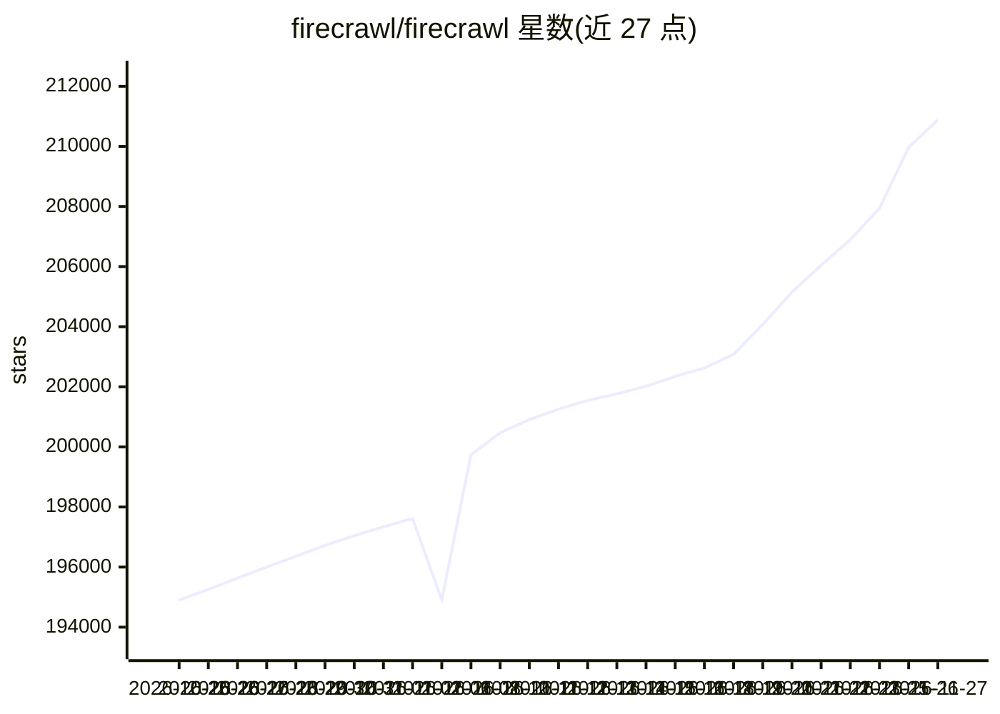

# firecrawl/firecrawl

⭐ 210,879 · TypeScript · AGPL-3.0 · 推送 2026-11-26 · [GitHub](https://github.com/firecrawl/firecrawl) · [官网](https://firecrawl.dev) · 组织维护

**给 AI Agent 提供网页抓取/搜索/数据接入的知识基础设施**

Firecrawl 将网页与数据源转为 LLM 可用的 markdown/JSON，提供三种使用方式：Firecrawl Local（单二进制本地运行，无数据库/队列，通过 MCP 接入 Agent）、Firecrawl Cloud（托管服务，含搜索、Alexandria 550+ 数据提供商、Interact 与 Agent）、自托管完整服务端（apps/api，含队列与数据库）。README 给出 Python/Node/Go 等 SDK、CLI 与 MCP 配置；本地 JS 渲染依赖机器上已有的 Chrome/Chromium，搜索与 Alexandria 需经 Firecrawl Cloud。

## 筛选速览

| 维度 | 判定 | 备注 |
|---|---|---|
| AI 角色 | `ai-ecosystem` | LLM/agent 周边工具 |
| 许可风险 | `viral` | AGPL-3.0 |
| 部署形态 | `self-host` | docker 或自建部署 |
| 模型依赖 | — | README 未给出锁定关系 |
| 硬件要求 | — | 无带数字的原话,不猜 |
| 安装摩擦 | `low` | 无编译、无系统依赖或容器化 |
| 成熟度 | — | 结构信号不足 |

## 动量与使用信号

- 维护:`active` — 距上次 push 0.7 天,年发版 7,166 位贡献者
- 涨星:近 1 天 **+426**(自 20261016 起算)
- 安装:pypi 包 `firecrawl-py` 月下载 5,339,910
- 平台:— · 协议:MCP

## 能力要点

- Firecrawl Local 以单二进制本地抓取/爬取/站点映射，并可作为 MCP 服务器接入 Agent
- 本地 serve 在 3002 端口提供 Firecrawl v2 API，SDK 指向本地 URL 即可用
- 提供 Python/Node/Go/Java/Rust/Ruby/.NET/PHP/Elixir 多语言 SDK
- Alexandria 通过单一 API 提供 550+ 数据提供商（人/公司/论文等结构化数据）

## 适用场景

- 让 AI Agent 抓取网页并读取干净的 markdown 上下文
- 为 RAG 或知识库管道批量爬取整站内容
- 通过 MCP 把抓取/爬取/搜索工具接入 Claude Code 等 Agent 工具
- 按 schema 从网页提取结构化 JSON 数据

## 场景标签

`网页抓取` `文档解析` · 领域:效率与自动化

## 证据(README 行号)

> L31: **Knowledge infrastructure to make your agents smarter. 🔥** You can use Firecrawl three ways. This repo holds the c
> L33: - **Firecrawl Local.** Run Firecrawl on your own machine as one binary that turns websites into clean markdown, plu
> L79: `init` finds Claude Code, Claude Desktop, Cursor, Windsurf, Gemini CLI and Codex on your machine and adds Firecrawl

## 星数曲线

2026-10-25 194,905 → 2026-11-27 210,879（+15,974）

---
*卡片 v1 · prompt 1.4 · 生成 2026-11-22 · 置信度 mid · 依据 README sha `43417199e6a1` · [字段定义](../../DATASET.md)*
