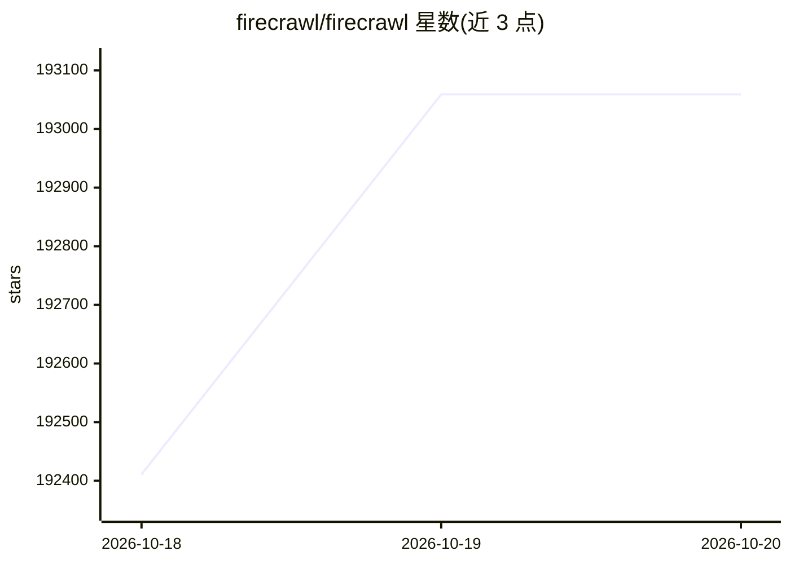

# firecrawl/firecrawl

⭐ 193,059 · TypeScript · AGPL-3.0 · 推送 2026-10-19 · [GitHub](https://github.com/firecrawl/firecrawl) · [官网](https://firecrawl.dev) · 组织维护

**面向 AI agent 的网页搜索/抓取/交互 API 与开源工具集**

Firecrawl 提供网页搜索、抓取、整站爬取、URL 发现、批量抓取与内容变更监控等 API，将网页与 PDF/DOCX 等文档转为 markdown、结构化 JSON 或截图，供 AI agent 使用。支持在页面上执行点击、滚动、输入等操作后提取内容，并提供描述需求的 Agent 端点（运行 spark-2 模型）。提供 Python/Node/Go/Java/Rust 等 SDK、CLI 与 MCP 集成，可接入 Claude Code 等 agent 客户端。AGPL-3.0 开源，另有含额外功能的云端托管版，支持自托管。

## 筛选速览

| 维度 | 判定 | 备注 |
|---|---|---|
| AI 角色 | `ai-ecosystem` | LLM/agent 周边工具 |
| 许可风险 | `viral` | AGPL-3.0 |
| 部署形态 | `library` | 以包/库形式分发 |
| 模型依赖 | — | README 未给出锁定关系 |
| 硬件要求 | — | 无带数字的原话,不猜 |
| 安装摩擦 | `medium` | 含编译或系统依赖之一 |
| 成熟度 | — | 结构信号不足 |

## 动量与使用信号

- 维护:`active` — 距上次 push 0.7 天,年发版 7,166 位贡献者
- 涨星:近 1 天 **+426**(自 20261016 起算)
- 安装:pypi 包 `firecrawl-py` 月下载 5,339,910
- 平台:— · 协议:MCP

## 能力要点

- 网页/文档转 markdown、JSON、截图等 LLM-ready 输出
- 页面交互（点击/滚动/输入）后提取内容
- Agent 端点：描述需求即自动搜索导航取数，支持 schema 结构化输出
- 提供多语言 SDK、CLI 与 MCP 接入方式

## 适用场景

- 为 AI agent 或 RAG 流程获取干净的网页上下文
- 整站爬取与批量抓取构建数据集
- 监控网站内容变更
- 把 PDF/DOCX 文档转为 markdown 供下游处理

## 场景标签

`网页抓取` `浏览器自动化` · 领域:效率与自动化

## 证据(README 行号)

> L31: **The API to search, scrape, and interact with the web at scale. Firecrawl is the context API for AI agents. 🔥** Op
> L213: Connect Firecrawl to any AI agent or MCP client in minutes.

## 星数曲线

2026-10-18 192,411 → 2026-10-20 193,059（+648）

---
*卡片 v1 · prompt 1.4 · 生成 2026-10-20 · 置信度 high · 依据 README sha `c63714794e25` · [字段定义](../../DATASET.md)*
