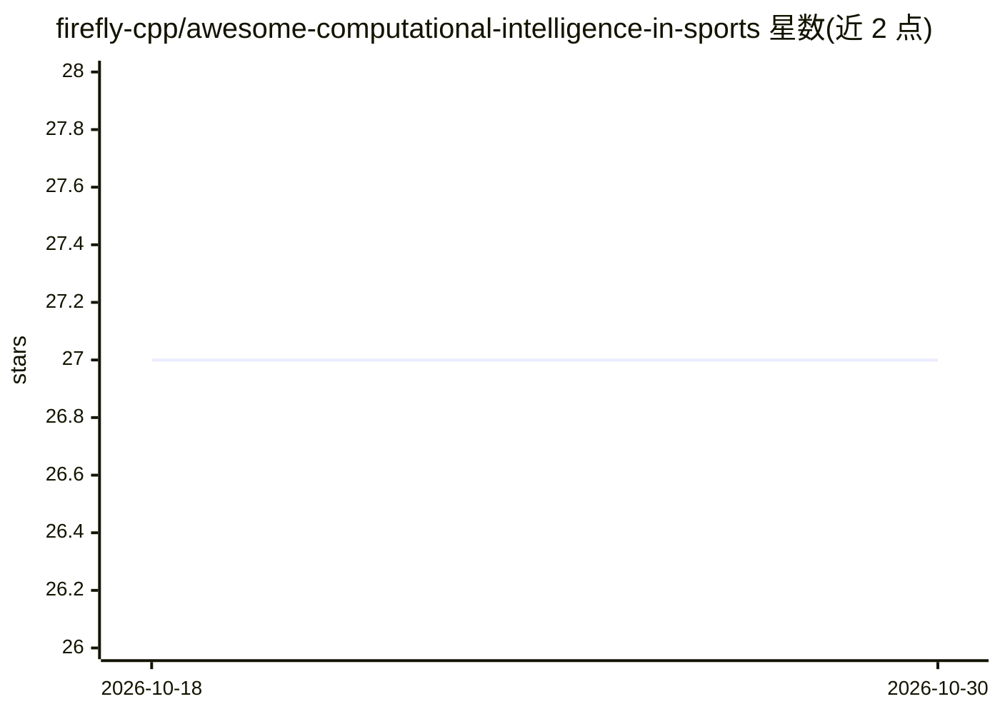

# firefly-cpp/awesome-computational-intelligence-in-sports

⭐ 27 · CC-BY-SA-4.0 · 推送 2025-12-07 · [GitHub](https://github.com/firefly-cpp/awesome-computational-intelligence-in-sports) · 个人维护

**计算智能在体育领域应用的文献策展清单**

面向体育领域计算智能研究者的知识清单：收录进化算法、人工神经网络、模糊系统、群智能等方法在体育中应用的书籍、综述论文、研究论文、数据集与软件。文献引用使用 Mendeley 以 MLA 8 格式整理，条目附 DOI/arXiv 链接，内容覆盖步态研究、训练计划生成、运动表现预测、可穿戴系统、数字孪生等主题。以 awesome list 形式组织，仓库提供 Zenodo DOI。

## 筛选速览

| 维度 | 判定 | 备注 |
|---|---|---|
| AI 角色 | `ai-knowledge` | 知识聚合/清单类 |
| 许可风险 | `viral` | CC-BY-SA-4.0 |
| 部署形态 | `None` |  |
| 模型依赖 | — | README 未给出锁定关系 |
| 硬件要求 | — | 无带数字的原话,不猜 |
| 安装摩擦 | `low` | 无编译、无系统依赖或容器化 |
| 成熟度 | — | 结构信号不足 |

## 能力要点

- 收录计算智能在体育领域的书籍、综述、研究论文、数据集与软件
- 方法覆盖进化算法、神经网络、模糊系统、群智能
- 引用条目以 MLA 8 格式整理并附 DOI/arXiv 链接

## 适用场景

- 查找计算智能方法在体育科学中的研究文献
- 调研运动表现预测、智能训练等方向的已有工作
- 了解体育分析领域可用的数据集与软件资源

## 场景标签

`精选清单` · 领域:学习与行业

## 证据(README 行号)

> L12: We are curating **awesome** research and approaches to **CI in Sports**!
> L14: This repository serves as a list of knowledge for researchers working in Computational Intelligence in Sports. The 

## 星数曲线

2026-10-18 27 → 2026-10-30 27（+0）

---
*卡片 v1 · prompt 1.4 · 生成 2026-10-26 · 置信度 high · 依据 README sha `6a3de57e0e8b` · [字段定义](../../DATASET.md)*
