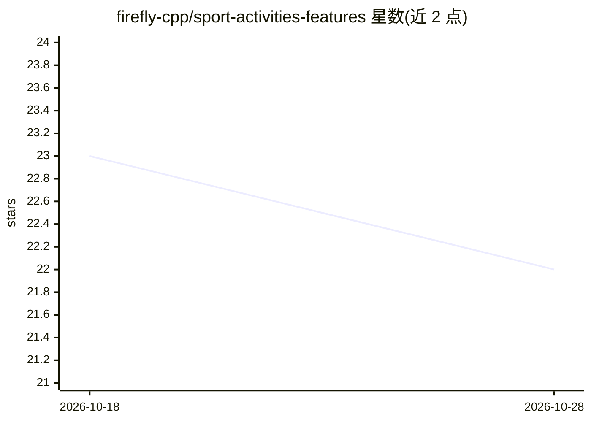

# firefly-cpp/sport-activities-features

⭐ 22 · Python · MIT · 推送 2026-10-28 · [GitHub](https://github.com/firefly-cpp/sport-activities-features) · 组织维护

**从 TCX/GPX 运动活动文件中提取特征的最小化 Python 工具箱**

面向运动数据分析的 Python 工具箱：读取 TCX/GPX 活动文件及 Overpass API 的 OpenStreetMap 节点，提取总距离、时长、卡路里等整体指标，以及丘陵数量与平均海拔、爬坡比、间歇训练数据、Banister/Lucia TRIMP 训练负荷等地形与阶段特征；支持接入 Visual Crossing 天气 API 获取历史天气、Open-Elevation/OpenTopoData 补全海拔、区域指标提取、死路与中断识别、TCX 转 GPX。提供 pip 与多个 Linux 发行版安装方式，附两个测试数据集、远程 API 与图形界面。发表于 INES 2021 会议（DOI 可查）。

## 筛选速览

| 维度 | 判定 | 备注 |
|---|---|---|
| AI 角色 | `ai-enhanced` | 去掉 AI 部分产品仍成立 |
| 许可风险 | `permissive` | MIT |
| 部署形态 | `library` | 以包/库形式分发 |
| 模型依赖 | — | README 未给出锁定关系 |
| 硬件要求 | — | 无带数字的原话,不猜 |
| 安装摩擦 | `low` | 无编译、无系统依赖或容器化 |
| 成熟度 | — | 结构信号不足 |

## 能力要点

- TCX/GPX/OSM 节点读取与整体及地形、间歇、训练负荷特征提取
- 集成 Visual Crossing 历史天气、Open-Elevation/OpenTopoData 海拔补全（可自托管或 Docker）
- 区域指标提取、死路与中断识别、TCX 转 GPX 转换
- 附带 pip/Alpine/Fedora/Arch 安装途径、两个基准数据集与远程 API、图形界面

## 适用场景

- 批量解析骑行/跑步记录文件并提取地形与训练负荷特征
- 为运动数据挖掘研究准备结构化特征数据
- 结合历史天气与海拔数据对活动做上下文分析

## 场景标签

`文档解析` · 领域:知识与检索

## 证据(README 行号)

> L40: Fortunately, our sport-activities-framework rises above these limitations, revealing a comprehensive panorama of yo
> L51: Prepare to be astounded by the capabilities of the sport-activities-features framework. It effortlessly handles TCX

## 星数曲线

2026-10-18 23 → 2026-10-28 22（-1）

---
*卡片 v1 · prompt 1.4 · 生成 2026-10-27 · 置信度 mid · 依据 README sha `8908ec93f4e5` · [字段定义](../../DATASET.md)*
