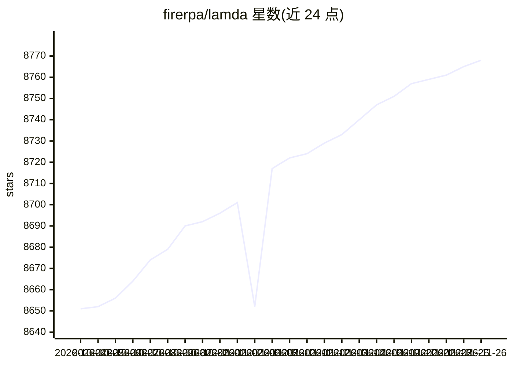

# firerpa/lamda

⭐ 8,768 · Python · MIT · 推送 2026-11-22 · [GitHub](https://github.com/firerpa/lamda) · [官网](https://device-farm.com/) · 组织维护 · 中文 README

**Android 全栈设备控制平台，含 AI Agent 与 MCP 接入**

运行在设备端的一体化 Android 控制平台，无需额外运行时依赖，支持多代 Android 与有/无 root 环境。PC 端通过 Python 客户端库调用 160+ API，覆盖 UI 自动化、浏览器远程桌面（MJPEG/H.264/WebRTC）、一键 MITM 抓包、内置 Frida 逆向、代理/VPN/frp/P2P 组网。内置 MCP server 与自然语言 agent 命令，可对接 OpenAI 兼容 API 做真机任务。部署方式包括一键 APP、Magisk 模块、ROM 集成，面向多设备集群长期运行。

## 筛选速览

| 维度 | 判定 | 备注 |
|---|---|---|
| AI 角色 | `ai-enhanced` | 去掉 AI 部分产品仍成立 |
| 许可风险 | `permissive` | MIT |
| 部署形态 | `desktop` | 安装包/桌面程序 |
| 模型依赖 | — | README 未给出锁定关系 |
| 硬件要求 | — | 无带数字的原话,不猜 |
| 安装摩擦 | `low` | 无编译、无系统依赖或容器化 |
| 成熟度 | `idea` | |

## 能力要点

- 内置 MCP server（streamable-http），兼容 Claude、Cursor 等 MCP 客户端
- agent 命令通过 OpenAI 兼容 API 以自然语言驱动设备，含视觉模式
- 浏览器远程桌面支持 MJPEG/H.264/WebRTC 与多用户并发访问
- OCR（paddleocr/easyocr）与设备端图像匹配支持游戏等无视图树场景

## 适用场景

- 搭建云手机池/设备农场做批量真机自动化
- 给 AI Agent 通过 MCP 接口操控真实 Android 设备
- 一键 MITM 抓包并配合 Frida 做动态分析
- 多设备集中管理与 P2P 远程访问

## 场景标签

`网络安全` `GUI 自动化` · 领域:效率与自动化

## 证据(README 行号)

> L5:  An all-in-one Android automation framework that combines on-device services, AI-ready agents, and extensible tool i
> L9: FIRERPA is an **all-in-one Android device control platform**. The server runs directly on the device with **no extra
> L69: FIRERPA includes an **MCP server** (`/mcp/`) on **streamable-http**, with tool calls, resource reads, prompts, prog

## 星数曲线

2026-10-24 8,651 → 2026-11-26 8,768（+117）

---
*卡片 v1 · prompt 1.4 · 生成 2026-11-22 · 置信度 high · 依据 README sha `8cfa96934570` · [字段定义](../../DATASET.md)*
