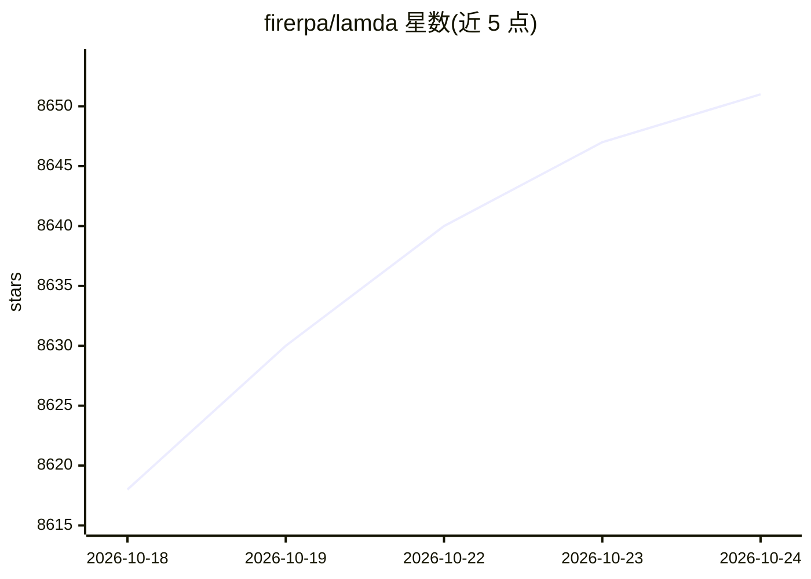

# firerpa/lamda

⭐ 8,651 · Python · MIT · 推送 2026-09-27 · [GitHub](https://github.com/firerpa/lamda) · [官网](https://device-farm.com/) · 组织维护 · 中文 README

**Android 全栈设备控制平台：远程桌面、自动化、抓包、逆向与 MCP/Agent**

在 Android 设备上直接运行服务端，PC 端通过 Python 客户端（160+ API）统一编排 UI 自动化、远程桌面（MJPEG/H.264/WebRTC）、一键 MITM 抓包、内置 Frida 逆向、代理/VPN/frp 网络、多设备集群管理与终端工具链。支持无 root 或 root 运行，覆盖 arm64 等多架构与真机/模拟器/云手机。AI 部分包括设备端 OCR/图像匹配（paddleocr/easyocr 可选后端）、MCP server 与通过 OpenAI 兼容 API 的自然语言 agent 命令。通过一键 APP、Magisk 模块或 ROM 集成部署。

## 筛选速览

| 维度 | 判定 | 备注 |
|---|---|---|
| AI 角色 | `ai-enhanced` | 去掉 AI 部分产品仍成立 |
| 许可风险 | `permissive` | MIT |
| 部署形态 | `desktop` | 安装包/桌面程序 |
| 模型依赖 | — | README 未给出锁定关系 |
| 硬件要求 | — | 无带数字的原话,不猜 |
| 安装摩擦 | `low` | 无编译、无系统依赖或容器化 |
| 成熟度 | — | 结构信号不足 |

## 能力要点

- 浏览器远程桌面（MJPEG/H.264/WebRTC，多用户并发，端到端 TLS）
- 一键 MITM 抓包与内置 Frida，无需单独 frida-server
- 设备端 OCR 与图像匹配（模板/SIFT），集群可集中识别
- 内置 MCP server（streamable-http），兼容 Claude、Cursor 等 MCP 客户端
- 160+ Python API 与 StarLink 多设备集中管理

## 适用场景

- 用 Python 脚本编排多台 Android 设备的 UI 自动化与抓包
- 通过浏览器远程调试与控制真机、模拟器或云手机集群
- 在设备上运行 Frida Hook 与逆向分析，无需 PC 侧工具切换
- 让 AI agent 通过 MCP 或自然语言命令操作真实设备

## 场景标签

`网络安全` `OCR` `GUI 自动化` · 领域:效率与自动化

## 证据(README 行号)

> L9: FIRERPA is an **all-in-one Android device control platform**. The server runs directly on the device with **no extra
> L67: ## AI / MCP / Agent
> L71: The built-in **`agent` command** drives the device in **natural language** via any OpenAI-compatible API with tool 

## 星数曲线

2026-10-18 8,618 → 2026-10-24 8,651（+33）

---
*卡片 v1 · prompt 1.4 · 生成 2026-10-21 · 置信度 high · 依据 README sha `a0e4823b65e1` · [字段定义](../../DATASET.md)*
