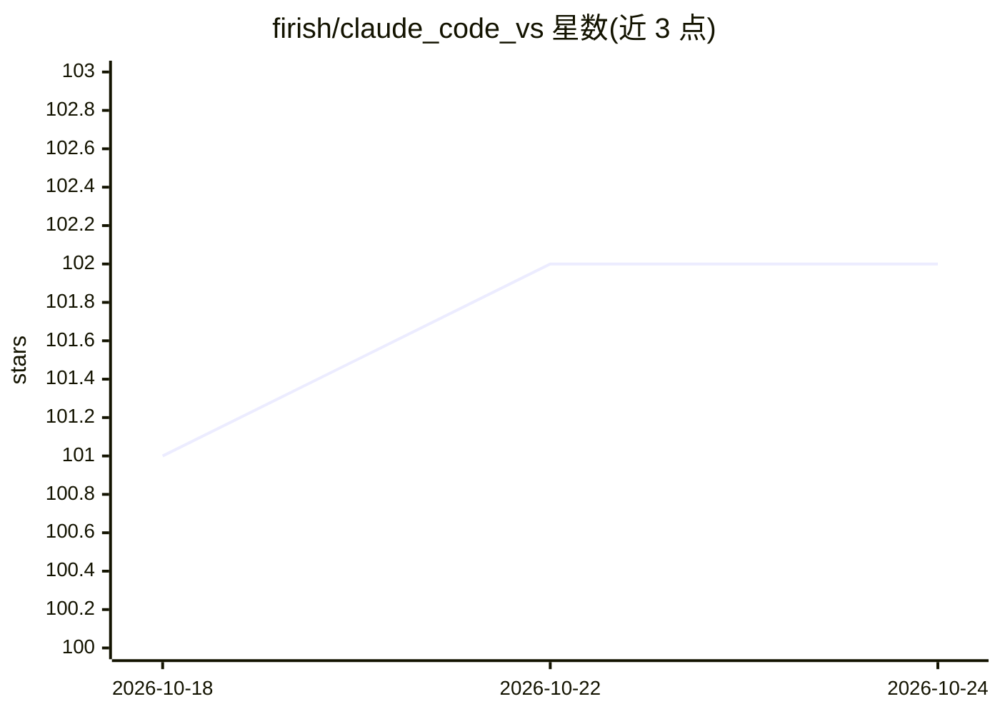

# firish/claude_code_vs

⭐ 102 · C# · MIT · 推送 2026-09-08 · [GitHub](https://github.com/firish/claude_code_vs) · [官网](https://marketplace.visualstudio.com/items?itemName=firish.bridgev1) · 个人维护 · 中文 README

**把 Claude Code 接入 Visual Studio 2026 的社区 IDE 扩展**

为 Visual Studio 2026 实现的 Claude Code IDE 集成扩展：claude CLI 负责 agent 工作，扩展充当集成协议的 IDE 半边。功能包括原生 diff 窗口（接受/拒绝/带反馈拒绝/自动接受）、Claude 读取编译器诊断与 Output 窗口并驱动 VS 自身构建、基于 Roslyn 的语义代码导航（引用查找/转到定义等）、Claude 可读取并驱动的实时调试器（步进/断点/数据断点/附加进程）、Test Explorer 测试发现与调试运行、截图与文件附加、简体中文界面。社区项目，与 Anthropic 无隶属，仅支持 VS 2026，基于 claude 2.1.223 测试。

## 筛选速览

| 维度 | 判定 | 备注 |
|---|---|---|
| AI 角色 | `ai-ecosystem` | LLM/agent 周边工具 |
| 许可风险 | `permissive` | MIT |
| 部署形态 | `None` |  |
| 模型依赖 | — | README 未给出锁定关系 |
| 硬件要求 | — | 无带数字的原话,不猜 |
| 安装摩擦 | `high` | 编译与系统依赖俱全 |
| 成熟度 | — | 结构信号不足 |

## 能力要点

- 原生 diff 窗口，接受/拒绝为唯一确认步骤
- Claude 读取运行时状态并可驱动调试器（含数据断点、附加进程）
- Roslyn 语义导航：引用查找/转到定义/实现查找/调用层级
- 通过 Test Explorer 发现、运行与调试测试，可追查不稳定测试

## 适用场景

- 在 Visual Studio 中用 Claude Code 做带 diff 审阅的编码辅助
- 让 Claude 驱动调试器定位运行时 bug 与死锁
- 让 Claude 基于真实编译错误和语义导航修改 C# 代码

## 场景标签

`编码 Agent` · 领域:编码与开发

## 证据(README 行号)

> L3: Bring Claude Code into **Visual Studio 2026**. The `claude` CLI does the agent work. This extension is the IDE half 
> L17: Claude Code ships first-class IDE integration for VS Code and JetBrains, but not Visual Studio. This extension impl

## 星数曲线

2026-10-18 101 → 2026-10-24 102（+1）

---
*卡片 v1 · prompt 1.4 · 生成 2026-10-23 · 置信度 high · 依据 README sha `2f7e98486497` · [字段定义](../../DATASET.md)*
