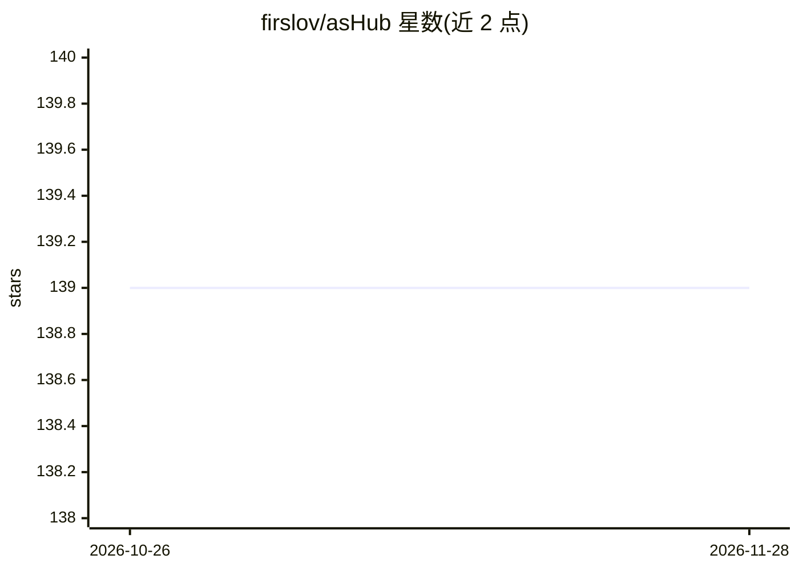

# firslov/asHub

⭐ 139 · JavaScript · MIT · 推送 2026-11-26 · [GitHub](https://github.com/firslov/asHub) · 个人维护 · 中文 README

**开源桌面 Agent 工作区：整合对话、模型、子代理与终端**

基于 agent-sh 内核的开源桌面工作区，将对话会话、模型配置、子代理任务、PTY 终端与项目文件放在同一界面。支持会话/项目管理、五个专职子代理（计划/探索/评审/研究/实现）、权限提示与变更预览、后台运行、Git worktree 隔离及插件系统。提供 macOS（Apple Silicon/Intel）、Windows x64、Linux x64 安装包，也可源码运行或作为本地 HTTP+SSE 服务。模型需用户自行接入 API 凭据或 Codex 登录，用量计费由服务商收取；对话历史存储在本地。

## 筛选速览

| 维度 | 判定 | 备注 |
|---|---|---|
| AI 角色 | `ai-native` | 本体是模型或模型工具 |
| 许可风险 | `permissive` | MIT |
| 部署形态 | `desktop` | 安装包/桌面程序 |
| 模型依赖 | — | README 未给出锁定关系 |
| 硬件要求 | — | 无带数字的原话,不猜 |
| 安装摩擦 | `low` | 无编译、无系统依赖或容器化 |
| 成熟度 | — | 结构信号不足 |

## 能力要点

- 五种桥接后端（内置 agent-sh 内核 / ACP 子进程 / PTY 终端），新增后端只需实现一个接口
- 子代理系统：plan、explore、review、research、implement 五类，可配置模型与预算
- 支持 Codex 登录、原生思考等级、上下文与缓存用量检查
- 设备互联与移动端 Web 应用，可跨设备继续已授权会话

## 适用场景

- 在桌面统一管理多个 AI 编码会话与子代理任务
- 通过权限提示和变更预览审查 Agent 的执行动作
- 用移动端查看家中电脑上正在运行的 Agent 任务
- 以本地 HTTP/SSE 服务形式让其他客户端接入会话

## 场景标签

`编码 Agent` `AI 助手` · 领域:编码与开发

## 证据(README 行号)

> L10: asHub is an open-source desktop workspace powered by agent-sh. Keep conversations, models, subagents, terminals and
> L12: Available for **macOS (Apple Silicon / Intel), Windows x64 and Linux x64**. The desktop app and local browser view 
> L31: |Tasks & subagents|Task progress and five specialists: plan, explore, review, research and implement; configurable 

## 星数曲线

2026-10-26 139 → 2026-11-28 139（+0）

---
*卡片 v1 · prompt 1.4 · 生成 2026-11-27 · 置信度 high · 依据 README sha `f3549ce2b795` · [字段定义](../../DATASET.md)*
