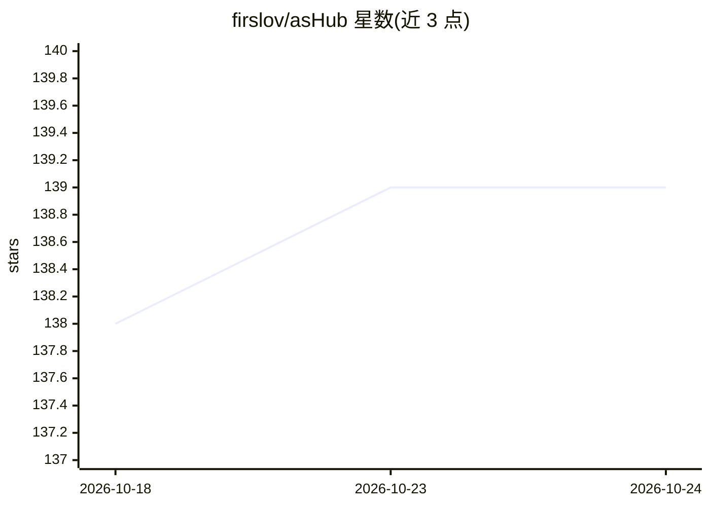

# firslov/asHub

⭐ 139 · JavaScript · MIT · 推送 2026-10-24 · [GitHub](https://github.com/firslov/asHub) · 个人维护 · 中文 README

**开源桌面 Agent 工作区：多会话并行对话与可审查执行轨迹**

基于 agent-sh 的开源桌面工作区（Electron + 浏览器共用同一客户端），把对话、模型切换、五个专业子代理（plan/explore/review/research/implement）、PTY 终端、文件浏览与项目文件组织在同一界面中。用户自带 provider 与 API 凭据，费用由 provider 计费。核心为桥接无关的 HTTP+SSE 服务，每个会话由一个 bridge 监管（内置 agent-sh 内核 / ACP 子进程 / PTY）。提供 macOS/Windows/Linux 桌面包，可源码运行；另有预览版手机访问功能，中继不端到端加密。

## 筛选速览

| 维度 | 判定 | 备注 |
|---|---|---|
| AI 角色 | `ai-native` | 本体是模型或模型工具 |
| 许可风险 | `permissive` | MIT |
| 部署形态 | `desktop` | 安装包/桌面程序 |
| 模型依赖 | — | README 未给出锁定关系 |
| 硬件要求 | — | 无带数字的原话,不猜 |
| 安装摩擦 | `low` | 无编译、无系统依赖或容器化 |
| 成熟度 | — | 结构信号不足 |

## 能力要点

- 五个专业子代理（plan/explore/review/research/implement），模型与预算可配置
- bridge 无关架构：agent-sh 内核 / ACP 子进程 / PTY 三种实现可切换
- 可审查执行：权限提示、变更预览、会话级批准、Markdown 导出与回溯分支
- macOS/Windows/Linux 桌面包自带运行时，无需另装 Node.js

## 适用场景

- 在桌面端集中管理多个项目的 Agent 对话、终端与文件
- 让不同专业子代理并行执行规划、调研、审查等任务
- 通过 ACP 接入 Claude Code 等外部 agent 后端
- 从手机继续桌面端的已授权对话

## 场景标签

`编码 Agent` · 领域:编码与开发

## 证据(README 行号)

> L10: asHub is an open-source desktop workspace powered by agent-sh. Keep conversations, models, subagents, terminals and
> L12: Available for **macOS (Apple Silicon / Intel), Windows x64 and Linux x64**. The desktop app and local browser view 
> L24: |Tasks & subagents|Task progress and five specialists: plan, explore, review, research and implement; configurable 

## 星数曲线

2026-10-18 138 → 2026-10-24 139（+1）

---
*卡片 v1 · prompt 1.4 · 生成 2026-10-23 · 置信度 high · 依据 README sha `7d8deaa3e1b3` · [字段定义](../../DATASET.md)*
