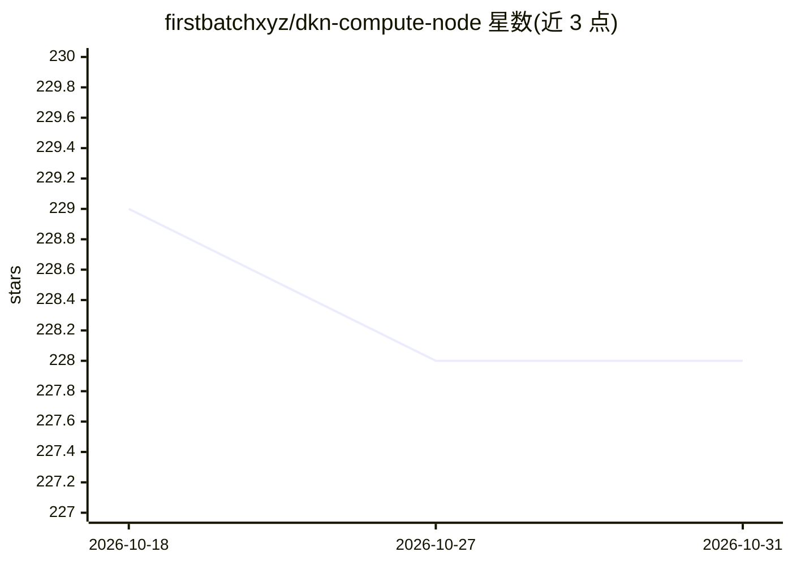

# firstbatchxyz/dkn-compute-node

⭐ 228 · Rust · Apache-2.0 · 推送 2026-06-24 · [GitHub](https://github.com/firstbatchxyz/dkn-compute-node) · [官网](https://dria.co/edge-ai) · 组织维护

**Dria 网络的计算节点：用本机跑推理模型赚取奖励**

由 FirstBatch 维护的 Rust CLI 程序，作为 Dria 知识网络的计算节点运行：setup 命令检测系统内存、列出适配模型、从 HuggingFace 下载 GGUF 模型并做测试推理与基准测速；start 命令连接网络、注册模型并对外服务推理请求，需提供钱包私钥，支持多模型并发。提供文本/音频/视觉三类 9 个内置模型（0.8-20GB），可通过 --gpu-layers 全量卸载到 Metal/CUDA/ROCm。安装途径含 Homebrew、shell 脚本、PowerShell 脚本与 GitHub Releases。

## 筛选速览

| 维度 | 判定 | 备注 |
|---|---|---|
| AI 角色 | `ai-ecosystem` | LLM/agent 周边工具 |
| 许可风险 | `permissive` | Apache-2.0 |
| 部署形态 | `None` |  |
| 模型依赖 | local-ok | 支持本地模型 |
| 硬件要求 | — | 无带数字的原话,不猜 |
| 安装摩擦 | `high` | 编译与系统依赖俱全 |
| 成熟度 | — | 结构信号不足 |

## 能力要点

- setup 交互式流程：内存检测、模型选择、GGUF 下载、测试推理与 tokens/s 基准
- 作为节点向 Dria 网络注册并服务推理请求，以钱包密钥结算奖励
- 支持多模型逗号分隔服务与 --max-concurrent 并发调节
- Metal/CUDA/ROCm GPU 加速与 ROCm 专用安装脚本

## 适用场景

- 把闲置机器接入 Dria 网络提供推理算力赚奖励
- 本地运行文本/音频/视觉小模型并对外服务
- 按内存大小挑选适配的量化模型部署

## 场景标签

`推理引擎` · 领域:训练与推理

## 证据(README 行号)

> L5:  Run AI inference on the Dria network. Earn rewards by serving models from your machine.

## 星数曲线

2026-10-18 229 → 2026-10-31 228（-1）

---
*卡片 v1 · prompt 1.4 · 生成 2026-10-22 · 置信度 high · 依据 README sha `c943c99385f1` · [字段定义](../../DATASET.md)*
