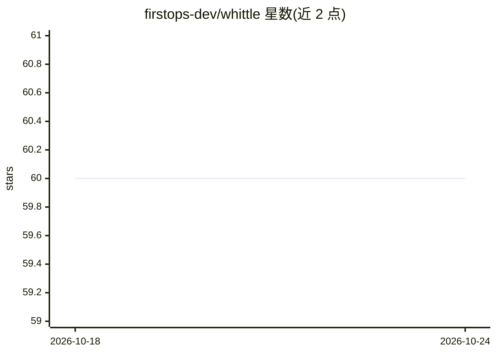

# firstops-dev/whittle

⭐ 60 · Go · Apache-2.0 · 推送 2026-07-10 · [GitHub](https://github.com/firstops-dev/whittle) · [官网](https://github.com/firstops-dev/whittle) · 组织维护

**为 Claude Code 压缩工具输出与路由模型以降低 token 用量的本地工具**

面向长时间运行 Claude Code 会话的工程师的本地压缩与路由工具。以 PostToolUse 钩子在工具输出进入上下文前压缩一次：JSON 无损重塑、日志有标记地删减、源码不动，异常时回退到原始字节；官方数据为 5000 个会话中 22% 工具输出缩减。可选模型路由器作为本地代理按策略文件把简单请求降级到便宜模型，压缩器主体为纯 Go 二进制、零外部依赖，Python 仅为可选 prose 模型与分类器服务。提供 npm/go/Homebrew 安装与 systemd 部署说明；支持 agent 目前仅 Claude Code，Cursor/Codex/OpenCode 在路线图上。

## 筛选速览

| 维度 | 判定 | 备注 |
|---|---|---|
| AI 角色 | `ai-ecosystem` | LLM/agent 周边工具 |
| 许可风险 | `permissive` | Apache-2.0 |
| 部署形态 | `library` | 以包/库形式分发 |
| 模型依赖 | locked-api |  |
| 硬件要求 | — | 无带数字的原话,不猜 |
| 安装摩擦 | `low` | 无编译、无系统依赖或容器化 |
| 成熟度 | — | 结构信号不足 |

## 能力要点

- 写时压缩：PostToolUse 钩子在输出进入上下文前压缩一次，不改动历史以保持 prompt cache
- 无损或有标记：JSON 字节级无损重塑、日志保留错误并标注省略行数、源码不触碰
- 可选模型路由：本地代理按可审计策略文件将请求降级到便宜模型，失败回退原始请求
- Go 二进制零外部依赖，全部组件本地运行，凭据不外发

## 适用场景

- 我跑长 Claude Code 会话，想在进入上下文前压缩工具输出以减少 token
- 我想按策略把简单请求自动路由到更便宜的模型，难的保留在强模型
- 我要求压缩不丢数据：数组行不删、源码不改、出错时回退原文

## 场景标签

`模型网关` · 领域:Agent 开发

## 证据(README 行号)

> L26: - 🪓 **Write-time compression**: a Claude Code PostToolUse hook whittles each tool output *before* it enters context
> L108: **Which agents?** Claude Code today (hook + router). Cursor, Codex, and OpenCode adapters are on the roadmap; the 

## 星数曲线

2026-10-18 60 → 2026-10-24 60（+0）

---
*卡片 v1 · prompt 1.4 · 生成 2026-10-24 · 置信度 high · 依据 README sha `9205f5ec8ca8` · [字段定义](../../DATASET.md)*
