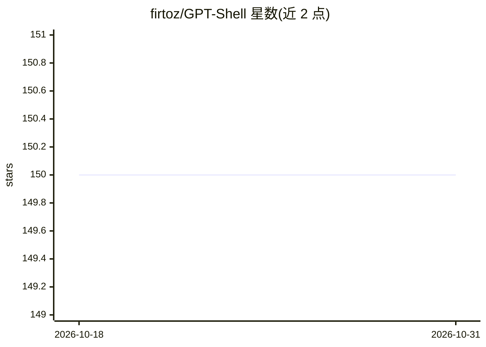

# firtoz/GPT-Shell

⭐ 150 · TypeScript · MIT · 推送 2026-10-21 · [GitHub](https://github.com/firtoz/GPT-Shell) · [官网](https://erin.ac?ref=github) · 个人维护

**基于 OpenAI 的 Discord 聊天机器人，支持对话与图像生成**

用 Node.js 和 TypeScript 编写的 Discord 聊天机器人，调用 OpenAI API 与用户进行对话，可按对话内容生成图像（draw 命令）。用户通过 /chat-gpt 命令、提及机器人或私信交互，支持多会话线程、自定义提示词（默认为软件工程师人设）。自 2.0.0 起提供基于 Pinecone 向量嵌入的长期记忆（实验性，代码长对话受 token 限制影响）。需配置 Discord bot token、MongoDB 连接串与 OpenAI API key，用 yarn 构建并以 pm2 常驻运行。README 顶部声明新版本已更名为 Erin。

## 筛选速览

| 维度 | 判定 | 备注 |
|---|---|---|
| AI 角色 | `ai-native` | 本体是模型或模型工具 |
| 许可风险 | `permissive` | MIT |
| 部署形态 | `library` | 以包/库形式分发 |
| 模型依赖 | — | README 未给出锁定关系 |
| 硬件要求 | — | 无带数字的原话,不猜 |
| 安装摩擦 | `low` | 无编译、无系统依赖或容器化 |
| 成熟度 | `idea` | |

## 能力要点

- Discord 多线程会话与自定义提示词人设
- 基于对话的图像生成（draw 命令）
- Pinecone 嵌入检索的长期记忆（实验性）
- Wolfram Alpha 能力与 pm2 常驻部署

## 适用场景

- 在 Discord 服务器里与 AI 伴侣聊天
- 通过自定义提示词设定机器人角色
- 在对话中让机器人生成图像

## 场景标签

`聊天机器人` `图像生成` · 领域:对话与助手

## 证据(README 行号)

> L6: GPT-Shell is an OpenAI based chat-bot that is similar to OpenAI's ChatGPT.
> L11: It can also generate images based on your conversation!

## 星数曲线

2026-10-18 150 → 2026-10-31 150（+0）

---
*卡片 v1 · prompt 1.4 · 生成 2026-10-22 · 置信度 mid · 依据 README sha `2d700b3e692c` · [字段定义](../../DATASET.md)*
