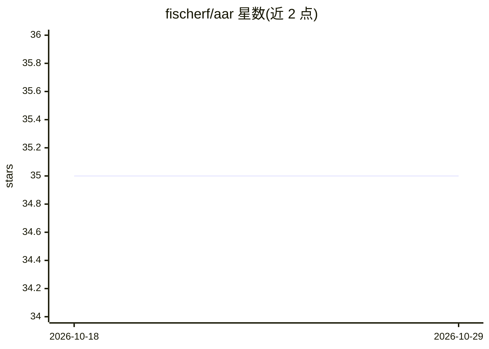

# fischerf/aar

⭐ 35 · Python · Apache-2.0 · 推送 2026-10-16 · [GitHub](https://github.com/fischerf/aar) · 个人维护

**面向开发者的开源编码 Agent，提供 CLI/TUI/IDE 集成**

用 Python 编写的编码 Agent（Adaptive Action & Reasoning Agent）：提供一次性运行、交互式 CLI/TUI、HTTP/SSE Web API 与 ACP 协议（接入 Zed/VSCode）等多种运行方式。核心机制包括类型化事件模型、沙箱化工具执行、子代理、可插拔扩展 API、JSONL 会话持久化与恢复、实时 token/成本追踪。支持 Anthropic/OpenAI/Ollama/Gemini 及 OpenAI 兼容端点，可会话中切换 provider。未发布到 PyPI，需源码安装；Windows 的 bash 工具需 WSL。

## 筛选速览

| 维度 | 判定 | 备注 |
|---|---|---|
| AI 角色 | `ai-native` | 本体是模型或模型工具 |
| 许可风险 | `permissive` | Apache-2.0 |
| 部署形态 | `library` | 以包/库形式分发 |
| 模型依赖 | local-ok | 支持本地模型 |
| 硬件要求 | — | 无带数字的原话,不猜 |
| 安装摩擦 | `low` | 无编译、无系统依赖或容器化 |
| 成熟度 | — | 结构信号不足 |

## 能力要点

- 多种运行方式：run/chat/tui/serve/acp，ACP 可接入 Zed 与 VSCode
- provider 无关，会话中经 /model 切换且保留对话历史
- 沙箱与安全机制：路径限制、命令拒绝列表、审批门、WSL Alpine 沙箱模式
- 三层自动发现的扩展系统与子代理（能力不超过父代理）

## 适用场景

- 在终端或 Zed/VSCode 里用 AI 编码助手完成代码任务
- CI 中一次性运行自动化编码任务
- 本地经 Ollama 运行模型做编码代理

## 场景标签

`编码 Agent` · 领域:编码与开发

## 证据(README 行号)

> L24: A lean, provider-agnostic agent framework with a thin core loop, typed event model, sandboxed tool execution, plugg
> L54: |`aar run "…"`|Automation / CI|One-shot task — runs to completion and exits; no interaction|
> L59: |`aar acp`|IDE integration|ACP stdio agent for Zed and other ACP-compatible editors|

## 星数曲线

2026-10-18 35 → 2026-10-29 35（+0）

---
*卡片 v1 · prompt 1.4 · 生成 2026-10-25 · 置信度 mid · 依据 README sha `4feb86cefb21` · [字段定义](../../DATASET.md)*
