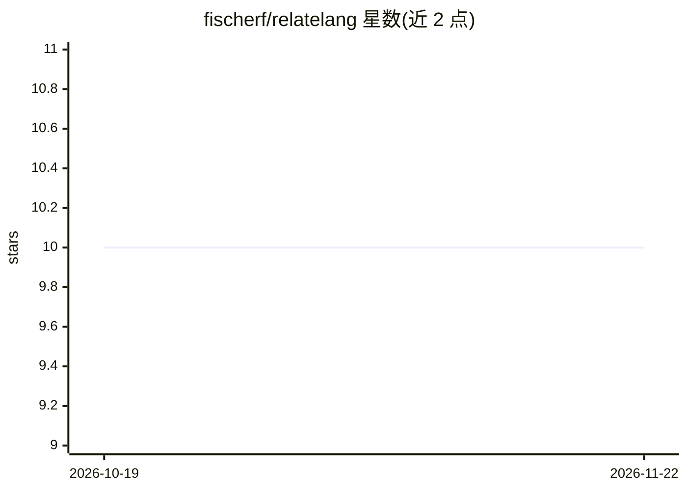

# fischerf/relatelang

⭐ 10 · 推送 2026-03-19 · [GitHub](https://github.com/fischerf/relatelang) · 个人维护

**给开发者生成结构化一致化 LLM 提示词的声明式元语言**

RelateLang（前身为 RelateScript）是一种声明式元语言，以关系与谓词逻辑为基础，用于编写结构化、可复用的 LLM 提示词。提供 define/predicate/attribute/relate/condition/ensure 六类语句与 eBNF 文法定义，无需解析器或编译器，直接由 LLM 解释。README 以论文形式阐述语法设计，并给出欺诈检测与配送路线优化两个示例，展示其在结构化输入、思维链引导与团队提示词标准化方面的用途。可见范围内未提供安装方式或可运行实现。

## 筛选速览

| 维度 | 判定 | 备注 |
|---|---|---|
| AI 角色 | `ai-ecosystem` | LLM/agent 周边工具 |
| 许可风险 | `none` | — |
| 部署形态 | `None` |  |
| 模型依赖 | — | README 未给出锁定关系 |
| 硬件要求 | — | 无带数字的原话,不猜 |
| 安装摩擦 | `low` | 无编译、无系统依赖或容器化 |
| 成熟度 | — | 结构信号不足 |

## 能力要点

- 六类语句构成的语言结构与 eBNF 文法定义
- 无需解析器/编译器，依赖 LLM 直接解释
- 提供欺诈检测与配送路线优化示例，含自然语言与 RelateLang 对照
- 支持与自然语言提示组合使用

## 适用场景

- 团队内统一生产代码中嵌入的 LLM 提示词格式
- 为多步推理任务编写结构化思维链提示词
- 将业务规则以可审查、可测试的提示词形式维护

## 场景标签

`提示工程` · 领域:Agent 开发

## 证据(README 行号)

> L4: **RelateLang** is a declarative meta-language designed to streamline the creation of structured and consistent promp
> L9: In the rapidly evolving field of large language models (LLMs), the effectiveness of interactions heavily relies on t
> L69: - **LLM-native interpretation**: No parsing or compiler needed; LLMs understand directly

## 星数曲线

2026-10-19 10 → 2026-11-22 10（+0）

---
*卡片 v1 · prompt 1.4 · 生成 2026-11-19 · 置信度 mid · 依据 README sha `13ef4fd18812` · [字段定义](../../DATASET.md)*
