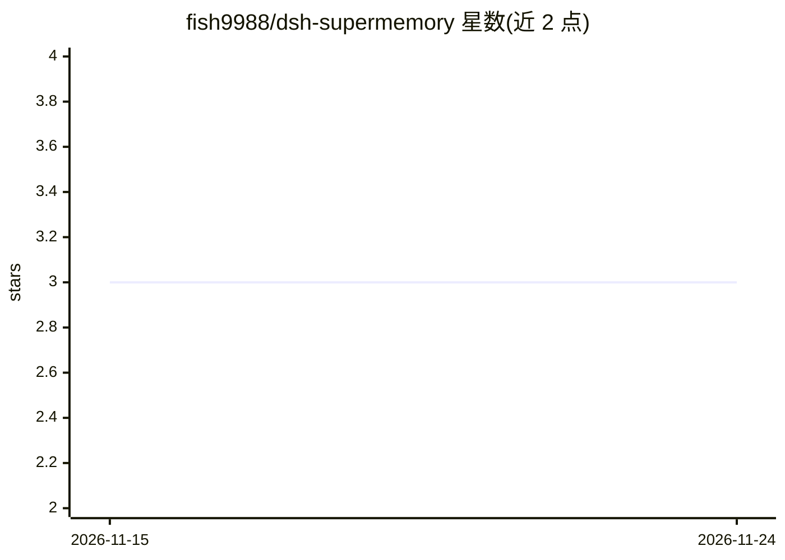

# fish9988/dsh-supermemory

⭐ 3 · JavaScript · MIT · 推送 2026-11-03 · [GitHub](https://github.com/fish9988/dsh-supermemory) · 个人维护 · 中文 README

**DSH 插件：跨会话长期记忆，语义召回与自动蒸馏**

面向 DeepSeek Harness (DSH) 用户、由 Supermemory 驱动的跨会话长期记忆插件：在每轮提问时做向量语义+历史切片混合检索，将相关画像与记忆注入上下文；对话静默 90 秒后后台调用指定模型提炼 add/update/delete 事实；写入前做中文字符 Bigram 与向量相似度（阈值 0.83）双层去重。需配置 Supermemory API Key（每月 $5 免费额度）。通过 DSH 插件机制安装，纯 JavaScript 实现，内置可视化记忆管理页，提供中英双语释义与时间词双路检索修复、敏感信息脱敏与 Prompt Injection 防护。

## 筛选速览

| 维度 | 判定 | 备注 |
|---|---|---|
| AI 角色 | `ai-enhanced` | 去掉 AI 部分产品仍成立 |
| 许可风险 | `permissive` | MIT |
| 部署形态 | `library` | 以包/库形式分发 |
| 模型依赖 | — | README 未给出锁定关系 |
| 硬件要求 | — | 无带数字的原话,不猜 |
| 安装摩擦 | `low` | 无编译、无系统依赖或容器化 |
| 成熟度 | — | 结构信号不足 |

## 能力要点

- 按需语义召回：混合检索画像、单句事实与历史会话片段，仅对主 Agent 生效
- 后台蒸馏：静默 90 秒后自动提炼增量事实，支持指定便宜快速模型
- 双层去重：Bigram 字面比对 + 向量相似度比对，变更事实自动原地更新
- 可视化记忆管理页：在线配置 Key、增删改查记忆、实时预览召回结果

## 适用场景

- 让 AI 助手跨会话记住技术栈约定、项目状态与截止日期
- 对话中直接说"记住…/我之前定的…是"，由 memory_save/search/forget 工具完成存取
- 工作区敏感项目通过 excludeWorkspaces 排除在记忆库之外
- 国内中文场景下解决 CJK 检索失效与时间词查询问题

## 场景标签

`Agent 记忆` · 领域:Agent 开发

## 证据(README 行号)

> L1: # dsh-supermemory · DeepSeek Harness 跨会话长期记忆插件
> L3: 让 **DeepSeek Harness (DSH)** 里的所有模型跨会话、跨工作区真正记住你——你的长期偏好、正在推进的项目、技术栈约定、关键截止日期以及过往会话中的重要结论。底层由 Supermemory 驱动，纯 JavaS
> L13: |**🧠 后台无感蒸馏（Mem0 式）**|对话停下 90 秒（可调）后，后台静默调用你指定的便宜/快速模型从增量对话提炼 `add / update / delete` 事实|**零主对话打扰**：不需要逼着正在干活的主模型每 

## 星数曲线

2026-11-15 3 → 2026-11-24 3（+0）

---
*卡片 v1 · prompt 1.4 · 生成 2026-11-22 · 置信度 high · 依据 README sha `d7c94c1124ec` · [字段定义](../../DATASET.md)*
