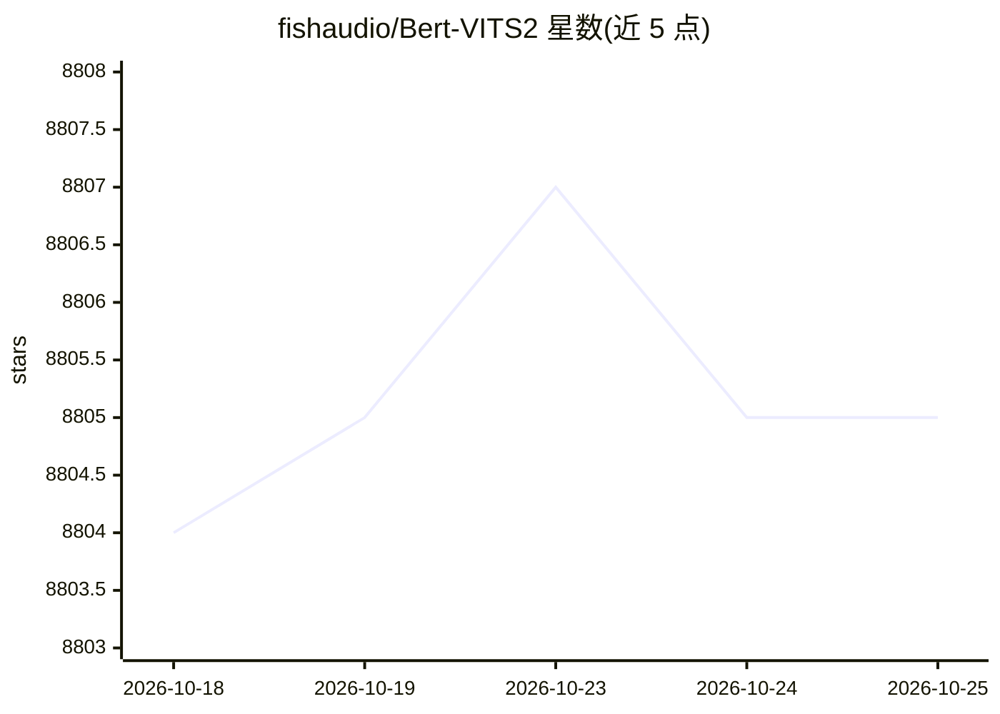

# fishaudio/Bert-VITS2

⭐ 8,805 · Python · AGPL-3.0 · 推送 2026-10-19 · [GitHub](https://github.com/fishaudio/Bert-VITS2) · 组织维护 · 中文 README

**融合多语言 BERT 的 VITS2 语音合成模型项目**

在 VITS2 骨干中引入多语言 BERT 的文本转语音（TTS）开源项目，核心思路来源于 anyvoiceai/MassTTS。README 提供简易上手指引 webui_preprocess.py，并附 Bilibili 演示视频与技术分享幻灯片。README 明确声明本项目短期内不再维护，推荐改用同一 FishAudio 下的 Fish-Speech 自回归 TTS 作为 Bert-VITS2/GSV 的替代。附使用合规限制条款。

## 筛选速览

| 维度 | 判定 | 备注 |
|---|---|---|
| AI 角色 | `ai-native` | 本体是模型或模型工具 |
| 许可风险 | `viral` | AGPL-3.0 |
| 部署形态 | `None` |  |
| 模型依赖 | — | README 未给出锁定关系 |
| 硬件要求 | — | 无带数字的原话,不猜 |
| 安装摩擦 | `low` | 无编译、无系统依赖或容器化 |
| 成熟度 | — | 结构信号不足 |

## 能力要点

- VITS2 骨干结合 multilingual BERT 的 TTS 实现
- 提供 webui_preprocess.py 简易教程与演示视频
- 参考并整合 MassTTS、vits、so-vits-svc 等多个项目

## 适用场景

- 训练多语言（含中文）个性化语音合成模型
- 学习 VITS2 与 BERT 结合的 TTS 训练流程
- 作为自托管 TTS 服务的基础模型

## 场景标签

`语音合成` · 领域:内容生成

## 证据(README 行号)

> L5: VITS2 Backbone with multilingual bert
> L12: # FishAudio下的全新自回归TTS Fish-Speech现已可用，效果为目前开源SOTA水准，且在持续维护，推荐使用该项目作为BV2/GSV的替代。本项目短期内不再进行维护。

## 星数曲线

2026-10-18 8,804 → 2026-10-25 8,805（+1）

---
*卡片 v1 · prompt 1.4 · 生成 2026-10-20 · 置信度 high · 依据 README sha `26e35b5d4fdc` · [字段定义](../../DATASET.md)*
