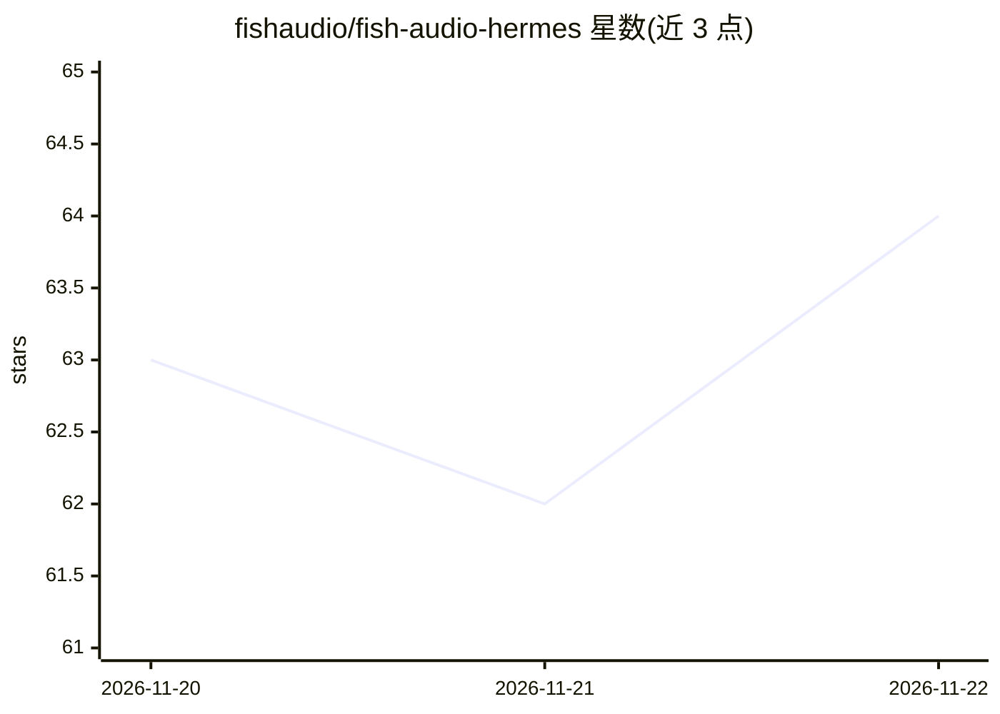

# fishaudio/fish-audio-hermes

⭐ 64 · Python · Apache-2.0 · 推送 2026-11-21 · [GitHub](https://github.com/fishaudio/fish-audio-hermes) · [官网](https://fish.audio) · 组织维护

**让 Hermes agent 说和听：接入 Fish Audio 语音合成与转写**

Fish Audio 的官方 Hermes Agent 插件，由 Electric Sheep 维护，运行于 Hermes CLI、消息应用与桌面端。将 Fish Audio 设为 Hermes 的语音与转写 provider：支持 80+ 语言的表达式语音（情绪/语气标签、多说话人）、语音库检索与别名、声音克隆与设计（经 Hermes 审批门）、实时听写与带说话人/时间戳/SRT 的转写。提供 /fish 系列命令与 fish_audio 工具集及脚本化 CLI；语音调用按 Fish Audio 计费，需 API key；Fish 语音转写不支持自定义词表。

## 筛选速览

| 维度 | 判定 | 备注 |
|---|---|---|
| AI 角色 | `ai-ecosystem` | LLM/agent 周边工具 |
| 许可风险 | `permissive` | Apache-2.0 |
| 部署形态 | `None` |  |
| 模型依赖 | — | README 未给出锁定关系 |
| 硬件要求 | — | 无带数字的原话,不猜 |
| 安装摩擦 | `low` | 无编译、无系统依赖或容器化 |
| 成熟度 | — | 结构信号不足 |

## 能力要点

- 表达式语音合成：情绪与语气标签、多说话人对话、自定义发音字典
- 语音库检索、别名管理、克隆与设计（默认经 Hermes 审批）
- 实时听写与 rich 转写（说话人、时间戳、SRT/WebVTT）
- 脚本化 CLI（--json、退出码）与 fish_audio 工具集、5 个插件 skill

## 适用场景

- 让 Hermes agent 用可克隆或设计的语音回复和朗读
- 把会议录音转成带说话人与字幕的文本
- 定时生成语音晨报（结合 Hermes cron）

## 场景标签

`语音合成` `语音识别` · 领域:内容生成

## 证据(README 行号)

> L7: The official Fish Audio plugin for Hermes Agent,
> L16: hermes plugins install 100yenadmin/fish-audio-hermes --enable --yes-deps
> L56: at the prompt or pass `--yes`. Once Fish Audio is the provider, voice replies,

## 星数曲线

2026-11-20 63 → 2026-11-22 64（+1）

---
*卡片 v1 · prompt 1.4 · 生成 2026-11-20 · 置信度 high · 依据 README sha `3af3d74529b4` · [字段定义](../../DATASET.md)*
