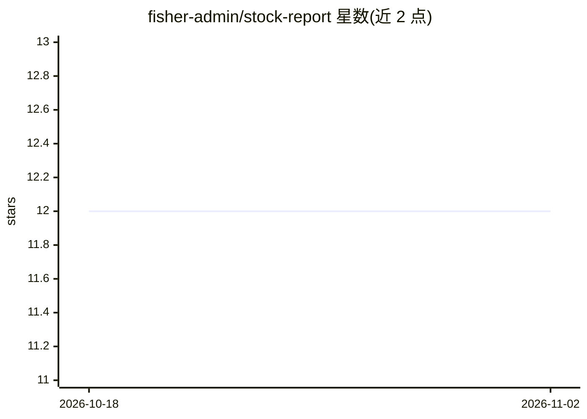

# fisher-admin/stock-report

⭐ 12 · Python · MIT · 推送 2026-10-30 · [GitHub](https://github.com/fisher-admin/stock-report) · [官网](https://fisher-admin.github.io/stock-report/) · 个人维护 · 中文 README

**A股量化研究 AI 流水线的公开展示层与结果发布仓库**

FisherQuant 是一条自主 AI agent 选股流水线的公开代码与结果仓库：本机完成行情计算与 AI 核对、策略评分、候选股选择与复盘，经规则闸门校验和白名单审计后，将脱敏结果摘要发布到 GitHub Pages 静态站点展示（首页、市场层、策略层、候选股、复盘研究等页面）。原始数据与逐股明细仅存本机；执行保持 observe-only，不接自动下单。仓库含公开层源码快照、发布闸门脚本、页面与边界回归测试，并声明不构成投资建议。

## 筛选速览

| 维度 | 判定 | 备注 |
|---|---|---|
| AI 角色 | `ai-native` | 本体是模型或模型工具 |
| 许可风险 | `permissive` | MIT |
| 部署形态 | `None` |  |
| 模型依赖 | — | README 未给出锁定关系 |
| 硬件要求 | — | 无带数字的原话,不猜 |
| 安装摩擦 | `low` | 无编译、无系统依赖或容器化 |
| 成熟度 | — | 结构信号不足 |

## 能力要点

- 每日市场判断→策略评分→候选选择→复盘的 AI 流水线，结果全部版本化可追溯
- 公开边界机制：白名单审计、隐私清理、合同校验，任一失败阻断发布
- GitHub Actions 部署静态 Pages 展示层，含页面与公开边界回归测试
- observe-only 设计：不接自动下单，不提供原始数据下载

## 适用场景

- 查看 A 股每日市场判断与候选股观察列表
- 审计公开结果与交易日、运行编号的对应关系
- 复用公开边界/发布闸门机制做类似的本机计算+公开摘要项目

## 场景标签

`金融量化` · 领域:学习与行业

## 证据(README 行号)

> L8: Public code and result summaries for FisherQuant: an A-share research pipeline that scores strategies, publishes an 
> L92: FisherQuant is a public display layer for an autonomous AI agent pipeline for A-share quantitative research. Its wo

## 星数曲线

2026-10-18 12 → 2026-11-02 12（+0）

---
*卡片 v1 · prompt 1.4 · 生成 2026-11-01 · 置信度 high · 依据 README sha `522b96f5b953` · [字段定义](../../DATASET.md)*
