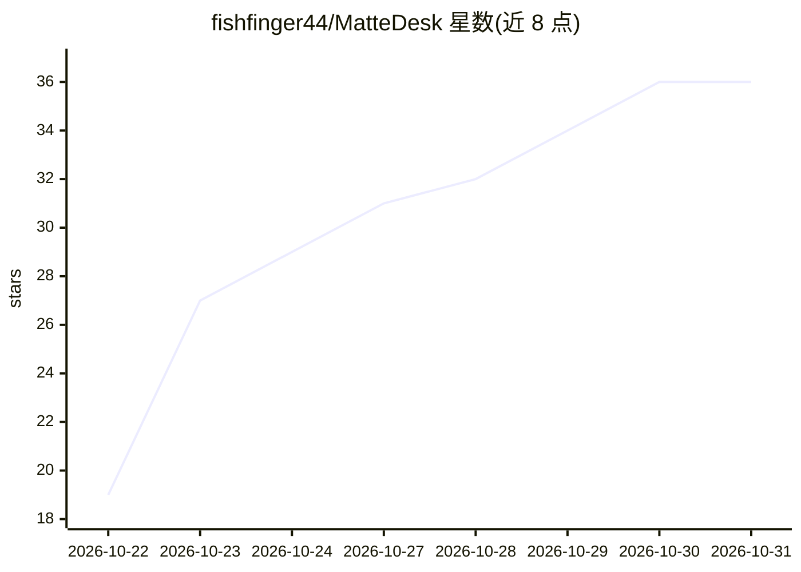

# fishfinger44/MatteDesk

⭐ 36 · Python · GPL-3.0 · 推送 2026-10-30 · [GitHub](https://github.com/fishfinger44/MatteDesk) · 个人维护

**浏览器中的 VFX 抠像工具：AI 生成多对象 alpha matte 并导出**

面向 VFX 合成的交互式抠像/roto 工具，在浏览器中运行：先检测并修复损坏的 plate 帧，再通过 SAM3.1、CoTracker3、MatAnyone2、VideoMaMa、ViTMatte/BiRefNet、LTX-2.5 等模型（经 ComfyUI）为多个对象生成整镜头 alpha matte，艺术家仅修正问题帧；提供逐帧 QA、边缘带控制、手动 Final Touch 与 Nuke/After Effects 导出。含 REST API 与 CLI 供 AI agent 与脚本调用，全部本地运行无需云与 LLM。提供 Windows 安装包，要求 Windows 10/11 与 NVIDIA GPU。

## 筛选速览

| 维度 | 判定 | 备注 |
|---|---|---|
| AI 角色 | `ai-native` | 本体是模型或模型工具 |
| 许可风险 | `dual` | GPL-3.0 |
| 部署形态 | `desktop` | 安装包/桌面程序 |
| 模型依赖 | — | README 未给出锁定关系 |
| 硬件要求 | `gpu-24g` | |
| 安装摩擦 | `medium` | 含编译或系统依赖之一 |
| 成熟度 | `idea` | |

## 能力要点

- plate 检测与修复（缺失/曝光跳变/位移/重复帧，四种修复方法）
- 多模型流水线生成整镜头多对象 alpha matte（SAM3.1/CoTracker3/MatAnyone2/VideoMaMa/BiRefNet/ViTMatte/LTX-2.5）
- 导出 EXR/PNG alpha、Nuke .nk 与 multichannel EXR、outputs.json 数据契约
- 本地 REST API 与 CLI 供 AI agent（如 Claude Code）调用，100% 本地无云

## 适用场景

- VFX 合成中替代逐帧手绘 roto，快速获得整镜头抠像
- 修复损坏 plate 帧后在 Nuke/After Effects 中直接使用
- 让 AI agent 或流水线脚本通过 API 批量跑抠像任务

## 场景标签

`图像视频处理` · 领域:感知与多模态

## 证据(README 行号)

> L5: **An interactive tool for cutting objects out of shots – alpha, matte, roto – right in the browser.**
> L9: `SAM3.1` · `CoTracker3` · `MatAnyone2` · `VideoMaMa` · `BiRefNet / ViTMatte` · `Sapiens2` · `LTX 2.5 Alpha Gen` · `C
> L99: - **SAM3.1** finds the object from points or a text prompt in keyframes and propagates the core through the shot; c

## 星数曲线

2026-10-22 19 → 2026-10-31 36（+17）

---
*卡片 v1 · prompt 1.4 · 生成 2026-10-26 · 置信度 high · 依据 README sha `54a742cfd2a0` · [字段定义](../../DATASET.md)*
