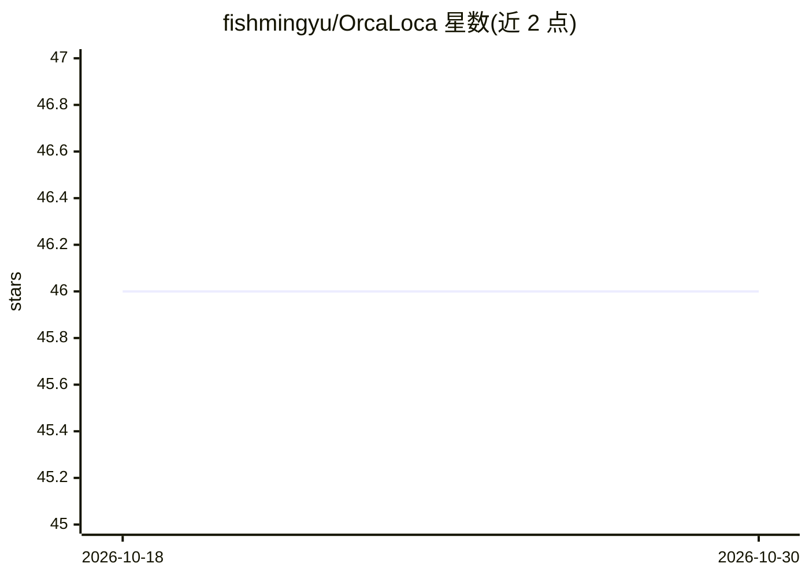

# fishmingyu/OrcaLoca

⭐ 46 · Python · MIT · 推送 2026-08-31 · [GitHub](https://github.com/fishmingyu/OrcaLoca) · [官网](https://fishmingyu.github.io/OrcaLoca/) · 组织维护

**ICML 25 论文：LLM agent 框架做软件 issue 定位**

OrcaLoca（前名 Orcar）是用于软件 issue 定位的 LLM agent 框架，整合优先级调度的 LLM 引导行动、带相关性评分的行动分解与距离感知的上下文剪枝；支持 top-K 检索模式与 Gemini（vertex API）。运行依赖 Docker（镜像 fork 自 SWE-Agent）与 OpenAI/Anthropic API key，通过 conda + pip install -e 安装，输出可用 SWE-Bench 官方脚本评估。含 ICML 25 论文。

## 筛选速览

| 维度 | 判定 | 备注 |
|---|---|---|
| AI 角色 | `ai-ecosystem` | LLM/agent 周边工具 |
| 许可风险 | `permissive` | MIT |
| 部署形态 | `self-host` | docker 或自建部署 |
| 模型依赖 | — | README 未给出锁定关系 |
| 硬件要求 | — | 无带数字的原话,不猜 |
| 安装摩擦 | `low` | 无编译、无系统依赖或容器化 |
| 成熟度 | — | 结构信号不足 |

## 能力要点

- 优先级调度、行动分解与距离感知上下文剪枝的 agent 机制
- 支持 OpenAI/Anthropic API 与 Gemini（vertex API）
- Docker 化运行（镜像 fork 自 SWE-Agent），输出对接 SWE-Bench 官方评估脚本

## 适用场景

- 在软件仓库中定位 bug/issue 对应的代码位置
- 复现论文实验或 SWE-Bench 排行榜提交结果
- 作为研究基线做 issue 定位方法对比实验

## 场景标签

`Agent 框架` · 领域:Agent 开发

## 证据(README 行号)

> L20: OrcaLoca (previous named Orcar), an LLM agent framework that improves accuracy for software issue localization by i
> L104: @misc{yu2025orcalocallmagentframework,

## 星数曲线

2026-10-18 46 → 2026-10-30 46（+0）

---
*卡片 v1 · prompt 1.4 · 生成 2026-10-25 · 置信度 high · 依据 README sha `5b79547f3952` · [字段定义](../../DATASET.md)*
