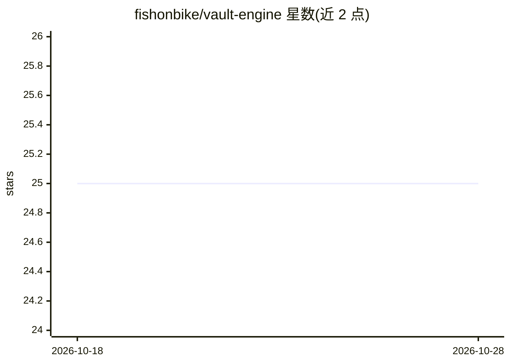

# fishonbike/vault-engine

⭐ 25 · Python · Apache-2.0 · 推送 2026-07-02 · [GitHub](https://github.com/fishonbike/vault-engine) · 个人维护 · 中文 README

**本地 LLM 隐私层：云端大模型前的中英文身份脱敏与还原**

在文本送入 ChatGPT/Claude/Gemini 等云端模型前，用本地运行的模型（默认 Ollama 后端）检测人名、机构、地点与准标识符，替换为稳定代号并生成仅存本地的还原映射；云端以代号作答后，本地命令将真实身份还原回回复。提供 CLI（含剪贴板一键脱敏/还原）与 Python 库，标准库零运行时依赖，三档脱敏策略；检测默认不出本机，后端不可用时降级为仅正则并非零退出。README 明示为尽力而为的去标识，非法律匿名化。

## 筛选速览

| 维度 | 判定 | 备注 |
|---|---|---|
| AI 角色 | `ai-native` | 本体是模型或模型工具 |
| 许可风险 | `permissive` | Apache-2.0 |
| 部署形态 | `library` | 以包/库形式分发 |
| 模型依赖 | local-ok | 支持本地模型 |
| 硬件要求 | — | 无带数字的原话,不猜 |
| 安装摩擦 | `low` | 无编译、无系统依赖或容器化 |
| 成熟度 | — | 结构信号不足 |

## 能力要点

- 本地 LLM 检测中英文姓名与 PII，代号化后可本地还原
- 标准库零运行时依赖，Python ≥3.9，Apache-2.0
- 剪贴板模式：粘贴到聊天机器人前就地脱敏，回复后一键还原
- balanced/max/light 三档脱敏策略，代码块可保持原样

## 适用场景

- 把私密笔记/合同粘贴给 ChatGPT 或 Claude 前先去掉真实身份
- 分享日志或工单给他人或 LLM 前做脱敏
- 对数据集去标识后用 LLM 分析，再把结果映射回真实身份

## 场景标签

 · 领域:数据隐私/LLM 输入预处理

## 证据(README 行号)

> L7: Strip the identities out of your text *before* it reaches ChatGPT / Claude /
> L38: `vault-engine` puts a **local model** in front as the detector, so the semantic

## 星数曲线

2026-10-18 25 → 2026-10-28 25（+0）

---
*卡片 v1 · prompt 1.4 · 生成 2026-10-27 · 置信度 high · 依据 README sha `ab357beed9dc` · [字段定义](../../DATASET.md)*
